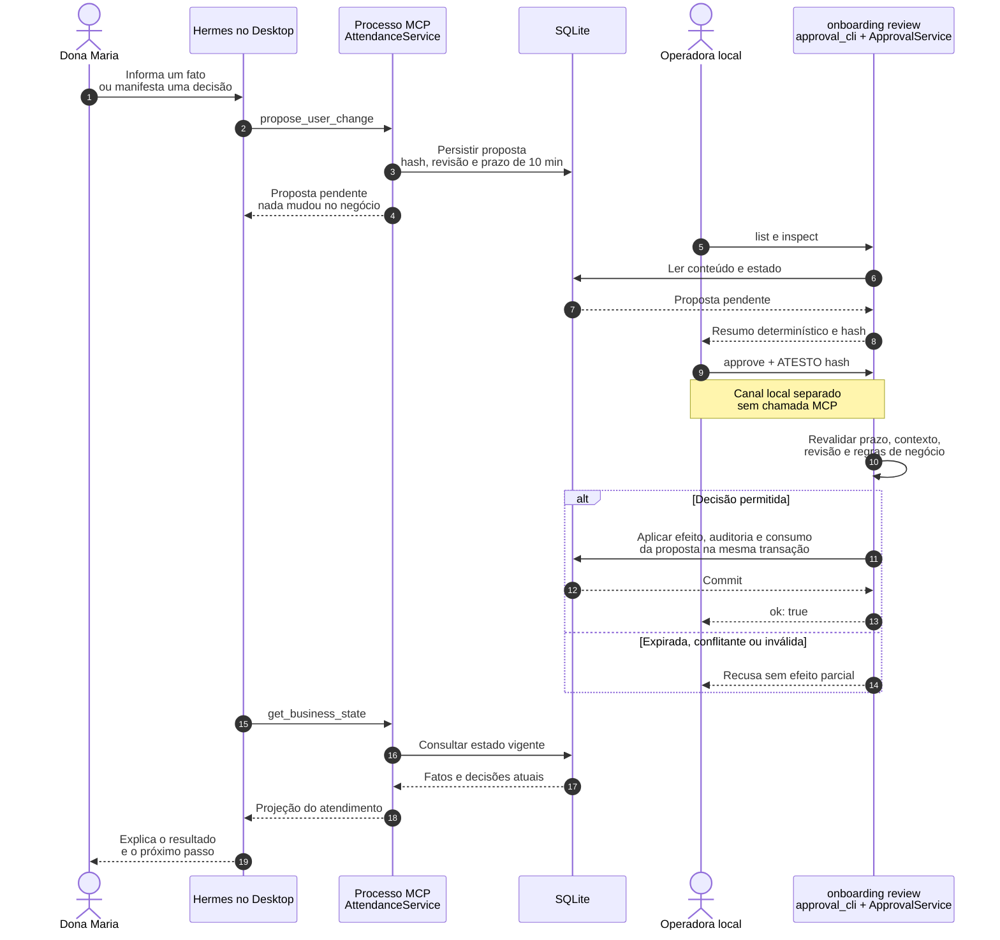
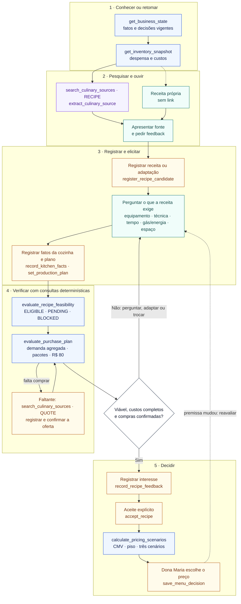

<a id="topo"></a>
<div align="center">

<h1>🍲 Sabor da Maria</h1>

<p><strong>Da despensa ao cardápio. Da conversa a uma decisão com números.</strong></p>
<p>Consultora conversacional de cardápio e precificação com Hermes Agent, MCP e Python.</p>
<p>Desafio técnico · Senior AI Engineer · iFood</p>

<p>
<a href="https://github.com/NousResearch/hermes-agent"></a>
<a href="https://www.python.org/"></a>
<a href="https://modelcontextprotocol.io/"></a>
<a href="https://docs.pydantic.dev/"></a>
<a href="https://www.sqlite.org/"></a>
</p>
<p>
<a href="https://github.com/glaucia86/sabor-da-maria-hermes-agent/actions/workflows/ci.yml"></a>
<a href="LICENSE"></a>
</p>
<p><a href="#comece-aqui">Em 1 minuto</a> · <a href="#arquitetura">Arquitetura</a> · <a href="#decisoes">Decisões</a> · <a href="#validar">Evidências</a> · <a href="#quick-start">Quick Start</a> · <a href="docs/demo/hermes-desktop-walkthrough.html">Guia da Dona Maria</a> · <a href="#sobre-mim">Sobre mim</a></p>
</div>

---

<a id="comece-aqui"></a>
## 🧭 Em 1 minuto

Dona Maria vai abrir o primeiro delivery. Ela tem uma planilha com a despensa e o
quanto pagou por cada ingrediente, R$ 80 para complementos e uma plataforma que
cobra 10% sobre a venda. Ela precisa saber **o que consegue produzir de verdade e
quanto cobrar**.

O Sabor da Maria customiza o Hermes Agent para conduzir essa conversa. A ideia
central é uma divisão de responsabilidades:

> **O LLM pesquisa, conversa e propõe. O domínio Python valida. A Dona Maria decide.**

- O Hermes pesquisa receitas reais, pergunta sobre a cozinha e explica os números.
- Um servidor MCP local valida viabilidade, estoque, orçamento agregado e preço, com tipos estritos e `Decimal`.
- Toda decisão vira uma **proposta**. Ela só vale depois de uma aprovação local, em outro processo, sem nenhuma tool de aprovação disponível ao modelo.
- O estado do negócio fica no SQLite, não na memória do LLM: uma conversa nova retoma o atendimento.

| Evidência | Resultado | Registro |
| --- | --- | --- |
| Jornada **REAL completa** no Hermes Desktop e no Hermes CLI, planilha original, 19/11/2026 | Pesquisa Exa real (TudoGostoso), receita declarada, fatos da cozinha, interesse, plano, aceite, CMV de R$ 2,42 por porção, três cenários e preço escolhido (M20, R$ 3,46), com 6 aprovações fora do modelo em cada ensaio. Falas da cozinheira interpretadas no ensaio, com dados declarados | [Jornada REAL completa](docs/verification-desktop-real-complete.md) |
| Jornada **REAL** no Hermes Desktop, planilha original, 17/11/2026 | Pesquisa Exa real, receita web e adaptação registradas, fatos da cozinha, plano, 5 decisões aprovadas fora do modelo e retomada em conversa nova. **Parou em `PENDING` antes do aceite:** faltavam tempo, peso da porção e base cru/cozido, e o domínio não aceitou suposições. | [Jornada REAL](docs/verification-desktop-real.md) |
| Jornada **SIMULATION** completa no Desktop, 17/11/2026 | Da pesquisa ao preço escolhido (cenário M30, R$ 2,03 por porção), com planilha sintética e intervenções operacionais registradas | [Jornada SIMULATION](docs/verification-desktop-e2e.md) |
| Testes determinísticos, 19/11/2026 | 998 aprovados e 4 ignorados: pytest, Hypothesis e MCP stdio real. CI verde em Windows, Ubuntu e macOS no commit `95a0e51` | [Evidências](#validar) |

> [!NOTE]
> **Não há vídeo gravado.** A demonstração é feita ao vivo no Hermes Desktop: a jornada REAL completa, da pesquisa ao preço, em um atendimento REAL novo preparado com a planilha original ([roteiro da demo](docs/speaker/demo-hermes.md)). Para reproduzir por conta própria, use o [Quick Start](#quick-start) e o [guia interativo](docs/demo/hermes-desktop-walkthrough.html), com prompts copiáveis. O guia é uma página HTML estática: depois de clonar, abra com `start docs\demo\hermes-desktop-walkthrough.html` (Windows), `open …` (macOS) ou `xdg-open …` (Linux).

## 📑 Sumário

- [O desafio e a solução](#desafio)
- [Arquitetura](#arquitetura)
- [Decisões de arquitetura](#decisoes)
- [Fluxo do agente](#experiencia)
- [Da planilha ao preço](#precificacao)
- [Evidências e limites](#validar)
- [Quick Start](#quick-start)
- [Como este projeto foi construído](#construcao)
- [Segurança](#seguranca)
- [Estrutura do repositório](#estrutura)
- [Sobre mim](#sobre-mim)

<a id="desafio"></a>
## 🎯 O desafio e a solução

O enunciado pede quatro capacidades e deixa a arquitetura a critério do
candidato. O centro do desafio é a **elicitação**: gostar de uma receita não
significa conseguir prepará-la. Uma condição desconhecida gera uma pergunta;
uma condição impeditiva exige adaptar a receita ou trocar de prato.

| Requisito do enunciado | Como foi implementado | Onde conferir |
| --- | --- | --- |
| §2.1 Pesquisar receitas reais e pedir feedback | Pesquisa mediada pelo Exa com termos liberados; fonte registrada por campo; interesse separado do aceite | [Jornada REAL](docs/verification-desktop-real.md), [research.py](src/dona_maria/research.py) |
| §2.2 Descobrir equipamentos, técnicas e restrições antes do aceite | Requisitos avaliados como `ELIGIBLE`, `PENDING` ou `BLOCKED` na escala do plano; `UNKNOWN` vira pergunta, nunca aprovação | [Viabilidade pendente no REAL](docs/verification-desktop-real.md#por-que-a-jornada-parou-antes-do-aceite), [test_acceptance.py](tests/unit/test_acceptance.py) |
| §2.3 Comparar com a despensa e caber no orçamento | Demanda agregada entre pratos, pacotes inteiros, encargos e limite único de R$ 80; cotação exige confirmação humana | [test_shared_plan.py](tests/unit/test_shared_plan.py), [quotes.py](src/dona_maria/quotes.py) |
| §2.4 CMV, 2–3 cenários e escolha da Dona Maria | CMV por origem, piso, três margens e preço personalizado; o cálculo nunca escolhe | [test_pricing.py](tests/unit/test_pricing.py), [Jornada SIMULATION](docs/verification-desktop-e2e.md) |
| §2 Hermes customizado, com decisões justificadas | Perfil exclusivo, context file, skill, dois plugins, MCP local e onboarding reproduzível | [Decisões](#decisoes), [guia de instalação](docs/setup.md) |
| §3 Planilha `despensa_dona_maria.xlsx` | Abas `Despensa` e `Precos` cruzadas por ingrediente, origem por célula, nada ausente vira zero | [Da planilha ao preço](#precificacao) |

<a id="arquitetura"></a>
## 🏗️ Arquitetura

O sistema roda em **três processos locais** que compartilham um único arquivo
SQLite. O modelo só alcança o domínio por oito tools; a aprovação humana está em
um processo que o modelo não enxerga.

```mermaid
%%{init: {"flowchart": {"rankSpacing": 45, "nodeSpacing": 28}, "themeVariables": {"fontFamily": "Arial, sans-serif"}}}%%
flowchart LR
    Maria(["Dona Maria"])
    Operadora(["Pessoa operadora"])

    subgraph Host["Host Hermes · perfil exclusivo"]
        direction TB
        UI["Hermes Desktop ou CLI"]
        LLM["Modelo LLM com tool calling<br/>escolhido no perfil"]
        Ctx[".hermes.md + skill<br/>dona-maria-cardapio"]
        Disp["Despacho de tools do Hermes"]
        Pol["Plugin de política<br/>hooks pre_tool_call e post_api_request"]
        Res["Plugin de pesquisa mediada<br/>search_culinary_sources<br/>extract_culinary_source"]
        UI <--> LLM
        Ctx -.->|"contexto"| LLM
        LLM -->|"tool calls"| Disp
        Pol -.->|"bloqueia fora da allowlist<br/>ou nome divergente"| Disp
        Disp -->|"2 tools"| Res
    end

    subgraph Proc["Subprocesso MCP stdio"]
        direction TB
        Srv["launcher + mcp_server<br/>6 tools de atendimento"]
        Dom["Domínio Python<br/>inventory · planning · quotes · pricing<br/>Pydantic + Decimal"]
        Srv --> Dom
    end

    subgraph Term["Terminal da operadora"]
        direction TB
        Onb["onboarding<br/>setup-real · configure · check · desktop"]
        Rev["onboarding review<br/>list · inspect · approve"]
    end

    DB[("SQLite do atendimento<br/>estado · propostas · auditoria<br/>fontes pesquisadas")]
    XLSX[/"despensa_dona_maria.xlsx"/]
    Web["Exa anônimo<br/>+ páginas de receitas"]

    Maria <-->|"conversa"| UI
    Disp -->|"6 tools"| Srv
    Res -->|"só termos liberados"| Web
    Res -->|"registra resultados"| DB
    Dom -->|"consulta · grava propostas e cálculos"| DB
    XLSX --> Onb
    Onb -->|"importa a despensa"| DB
    Onb -.->|"cria o perfil e abre o Desktop"| UI
    Operadora --> Rev
    Rev -->|"revalida e aplica<br/>na mesma transação"| DB
    Maria -.->|"manifesta a decisão"| Operadora

    classDef pessoa fill:#FDF2F8,stroke:#BE185D,color:#831843
    classDef host fill:#F0FDFA,stroke:#0F766E,color:#134E4A
    classDef dominio fill:#EFF6FF,stroke:#1D4ED8,color:#172554
    classDef operador fill:#FFFBEB,stroke:#B45309,color:#78350F
    classDef externo fill:#F5F3FF,stroke:#7C3AED,color:#4C1D95
    class Maria,Operadora pessoa
    class UI,LLM,Ctx,Disp,Pol,Res host
    class Srv,Dom,DB dominio
    class Onb,Rev operador
    class Web,XLSX externo
```



| Fronteira | O que roda ali | O que ela garante |
| --- | --- | --- |
| **Host Hermes** | Conversa, LLM, `.hermes.md` + skill e os dois plugins. O plugin de pesquisa roda dentro do host, carrega `dona_maria` de `src/` e grava as fontes pesquisadas no mesmo SQLite | O catálogo efetivo é 6 + 2 tools. O plugin de política confere se a tool executada é a mesma que o modelo pediu. A pesquisa só usa termos liberados e IDs de resultados registrados |
| **Subprocesso MCP stdio** | [`launcher`](src/dona_maria/launcher.py) → [`mcp_server`](src/dona_maria/mcp_server.py) → domínio | O launcher repassa só variáveis de sistema e o binding do operador (banco, workspace, modo), sem credenciais do provedor. O modelo não escolhe banco nem workspace. Schemas recusam campos extras; o frame tem limite de tamanho |
| **Terminal da operadora** | [`onboarding`](src/dona_maria/onboarding.py) e [`approval_cli`](src/dona_maria/approval_cli.py) com `ApprovalService` | A importação e a aprovação acontecem fora do catálogo do modelo. A aprovação exige o hash exato e revalida prazo, revisão e regras antes de aplicar |

### Como uma proposta vira uma decisão

A manifestação da Dona Maria e a atestação da operadora têm papéis distintos.
A operadora confere o conteúdo exato e atesta que ela tomou aquela decisão; não
decide por ela. Na avaliação, a mesma pessoa pode exercer os dois papéis. Esse
canal é uma decisão de arquitetura deste projeto, não uma exigência do enunciado.



Não há transação aberta enquanto se espera a pessoa. Replay idempotente não
duplica efeitos; um resultado histórico não restaura uma aprovação vigente; uma
resposta perdida exige consultar o estado antes de anunciar sucesso.

<a id="decisoes"></a>
## 🧩 Decisões de arquitetura

O enunciado deixa a critério do candidato **modelo, context files, tools/MCP,
estrutura de memória e skills**. Cada eixo abaixo traz a decisão, o motivo e o
custo aceito.

| Eixo | Decisão | Por quê | Custo aceito |
| --- | --- | --- | --- |
| **Modelo** | Escolhido pela avaliadora no seletor nativo do Hermes; precisa de tool calling. Observado: `openai/gpt-6.1-sol` (provedor Nous) nas jornadas REAL e SIMULATION | Reprodução sem credenciais da autora. As regras não dependem do modelo: a matemática e os guards estão no Python | A qualidade da elicitação varia por modelo; não há comparação publicada de qualidade, custo e latência |
| **Context files** | [`.hermes.md`](.hermes.md) define papel, linguagem simples, condução e limites. No Desktop, o onboarding incorpora a skill ao contexto da pasta de conversa, porque o Desktop não recebe `--skills` | Tom e condução ficam no prompt; nenhuma regra de negócio depende só dele | Instruções orientam, mas não impõem. Por isso existe o plugin de política e a validação no Python |
| **Tools / MCP** | MCP local via stdio com **6 tools**: 4 consultas, `propose_user_change` e `calculate_pricing_scenarios`. Os 13 comandos de negócio só entram como proposta tipada | Contratos explícitos, testáveis sem LLM, sem servidor HTTP. O modelo não tem tool de escrita direta nem de aprovação | Mais idas ao terminal; sem autenticação remota multiusuário |
| **Memória** | Memória automática e perfil de usuário do Hermes **desligados**. Fatos, plano, aceites e preços vêm do SQLite por `get_business_state` | Memória de LLM não é confiável para orçamento ou aceite. A jornada REAL comprovou a retomada em conversa nova | O agente consulta o estado com frequência (26 consultas no ensaio SIMULATION) |
| **Skills** | Skill [`dona-maria-cardapio`](skills/dona-maria-cardapio/SKILL.md) com referências carregadas por etapa: ingredientes, viabilidade, compras, precificação e correções | *Progressive disclosure*: o contexto da conversa só recebe o procedimento da etapa atual | A skill precisa acompanhar os contratos; mudanças exigem nova rodada de evals |
| **Plugins** | [Política](src/dona_maria/hermes_policy/__init__.py): allowlist 6 + 2 e conferência de que a tool executada é a pedida. [Pesquisa](src/dona_maria/hermes_research/__init__.py): Exa anônimo, termos liberados, extração com limites contra SSRF | No desenvolvimento, o reparo de nomes do host podia redirecionar uma chamada proibida para uma permitida; o hook bloqueia a divergência | Dependem da versão do host: o plugin recusa outra versão que não a 0.23.1 no commit fixado |
| **Persistência** | SQLite com revisão esperada, idempotência por operação, auditoria na mesma transação e contextos `REAL`/`SIMULATION` imutáveis por banco | Retomada, replay seguro e invalidação de decisões dependentes sem infraestrutura externa | Atende o protótipo local; multiusuário exigiria reavaliar armazenamento e identidade |
| **Aritmética** | Pydantic 2 nas fronteiras e `Decimal` com 34 dígitos; preço arredondado **para cima** em centavos | Um preço nunca cai abaixo do piso por arredondamento | Validação estrutural não comprova que um fato informado é verdadeiro |

`AGENTS.md` e `RULES.md` orientam o desenvolvimento com agentes de código; não
fazem parte do contexto do atendimento.

<a id="experiencia"></a>
## 💬 Fluxo do agente

O diagrama mostra uma jornada típica, não um roteiro fixo. O Hermes reutiliza os
fatos vigentes e pergunta só o que falta para a receita e a quantidade em
discussão. Os nós em âmbar passam por `propose_user_change` e aprovação local.



**Exemplo da jornada REAL:** a receita de arroz com frango da Nestlé publica 30
minutos de preparo. O agente não tratou esse número como o tempo da cozinha da
Maria. Com o plano de 4 porções registrado, a viabilidade ficou `PENDING` e o
agente perguntou, uma coisa por vez, tempo efetivo, base cru/cozido, capacidade
útil da panela e peso da porção.

**Exemplo da jornada REAL completa (19/11):** a pesquisa trouxe o frango
acebolado do TudoGostoso, com sobrecoxa; a cozinheira registrou a própria versão
com peito, tudo cru, e as três categorias revisadas. Com 60 minutos declarados
para 40 exigidos, a viabilidade ficou `ELIGIBLE`; o estoque cobriu tudo (R$ 0,00,
saldo R$ 80,00) e, depois do aceite, o cálculo deu CMV de R$ 2,42 por porção e o
cenário M20 de R$ 3,46 foi escolhido. Quando o agente propôs o plano antes de a
quantidade ser confirmada, a atestação local não o aplicou.

### Catálogo do modelo

| Tool | Quando o agente usa | Efeito |
| --- | --- | --- |
| `get_business_state` | Ao iniciar, retomar ou conferir uma alteração | Consulta fatos, pendências, propostas e decisões vigentes |
| `get_inventory_snapshot` | Ao comparar uma receita com a despensa | Consulta ingredientes, quantidades, custos e diagnósticos |
| `evaluate_recipe_feasibility` | Ao verificar a receita nas condições da cozinha | Avalia os requisitos no plano atual; não aceita o prato |
| `evaluate_purchase_plan` | Ao consolidar faltantes de todos os pratos | Avalia demanda, pacotes, desembolso e lacunas; não compra |
| `propose_user_change` | Ao registrar receita, fato ou decisão manifestada | Persiste uma proposta para revisão local; não aplica nada |
| `calculate_pricing_scenarios` | Depois de um aceite local vigente | Persiste o cálculo e os cenários; não escolhe preço |
| `search_culinary_sources` | Ao pesquisar receitas (`RECIPE`) ou ofertas (`QUOTE`) | Busca só termos liberados pela operadora; 1 resultado por busca |
| `extract_culinary_source` | Ao ler um resultado registrado | Extrai por ID; conteúdo externo é dado não confiável |

As seis primeiras vêm do MCP ([`ATTENDANCE_TOOLS`](src/dona_maria/business_state.py));
as duas últimas, do plugin de pesquisa. Os **13 comandos** aceitos por
`propose_user_change` são: `register_recipe_candidate`, `record_kitchen_facts`,
`record_user_preferences`, `record_recipe_feedback`, `set_production_plan`,
`accept_recipe`, `save_menu_decision`, `record_ingredient_conversion`,
`resolve_recipe_ingredient`, `register_complement_quote`,
`confirm_complement_quote`, `record_inventory_acquisition` e
`record_operational_resource` ([approvals.py](src/dona_maria/approvals.py)).
O construtor legado `create_server`, com 16 tools de escrita direta, serve a
testes locais e não é o launcher do atendimento.

<a id="precificacao"></a>
## 🧮 Da planilha ao preço

**Quantidade em estoque determina disponibilidade; quantidade comprada determina
custo unitário.** O importador cruza as abas `Despensa` e `Precos` pelo nome do
ingrediente, preserva a origem por célula e aponta ambiguidades. Quantidade,
preço ou conversão ausentes não viram zero.

| Dado de entrada | Tratamento |
| --- | --- |
| Arroz: 5 kg por R$ 24,90 | `24,90 / 5.000 = R$ 0,00498/g` |
| Alcaparras: 1 `balde 2kg` | A embalagem informa 2.000 g; o custo usa essa quantidade |
| `un 500g`, `un 400g`, `un 500ml`, `un 100ml` | Normalizados para gramas ou mililitros |
| Cobertura de chocolate: 1 `un` | Sem peso informado; se a receita pedir gramas, a conversão precisa ser esclarecida |

Os faltantes de **todos os pratos** são somados antes da compra. O limite
inclusivo de R$ 80 considera pacotes inteiros e encargos; o CMV considera só o
que a receita consome. Uma oferta sem preço, conteúdo ou frete conhecidos fica
pendente, e confirmar uma oferta não efetua a compra. Selecionar o cardápio não
baixa o estoque físico.

```text
custo unitário  = preço total pago / quantidade comprada
CMV do lote     = soma(quantidade usada × custo unitário), por origem
CMV por porção  = CMV do lote / rendimento do lote
preço mínimo    = CMV por porção / 0,90
preço p/ margem m sobre a venda = CMV por porção / (0,90 − m)
sobra após taxa e ingredientes  = 0,90 × preço − CMV por porção
```

Exemplo verificado nos testes, com **CMV de R$ 10,00 por porção**:

| Opção | Preço de venda | Taxa de 10% | Sobra após taxa e ingredientes |
| --- | --- | --- | --- |
| Piso | R$ 11,12 | R$ 1,11 | R$ 0,01 |
| Margem de 10% | R$ 12,50 | R$ 1,25 | R$ 1,25 |
| Margem de 20% | R$ 14,29 | R$ 1,43 | R$ 2,86 |
| Margem de 30% | R$ 16,67 | R$ 1,67 | R$ 5,00 |

O enunciado pede dois ou três cenários; as margens de 10%, 20% e 30% são uma
escolha desta implementação. O enunciado chama `0,90 × P − CMV` de lucro; o
atendimento o chama de **sobra após ingredientes e taxa**, porque embalagem,
gás/energia e trabalho não estão na planilha. Dona Maria escolhe um cenário ou um
preço próprio acima do piso, e a escolha passa pela mesma aprovação local. A taxa
de 10% é premissa do desafio, não uma afirmação sobre o repasse real do iFood.

<a id="validar"></a>
## ✅ Evidências e limites

Cada camada prova uma coisa diferente. Nenhuma substitui as outras.

| Camada | O que prova | O que não prova | Registro |
| --- | --- | --- | --- |
| Testes determinísticos | 998 aprovados e 4 ignorados em 19/11/2026 (5 min 54 s com `-n 2`; os ignorados são três casos de symlink sem privilégio no Windows e o probe opcional do Hermes instalado): importação, viabilidade, orçamento agregado, aprovação, concorrência, rollback, replay, invalidação e retomada. Hypothesis explora sequências de alterações | Qualidade da conversa ou pesquisa real | Comandos abaixo |
| Integração MCP stdio | Servidor real por stdio, limites de frame, catálogo de 6 tools, reinício e replay | Comportamento do modelo | [tests/integration](tests/integration) |
| CI | Lint, formatação e suíte em Windows, Ubuntu e macOS, verde no commit `95a0e51` | Hermes, modelo ou Desktop (não instala o host) | [ci.yml](.github/workflows/ci.yml) |
| Jornada REAL no Desktop | Planilha original, pesquisa Exa real, 5 decisões aprovadas fora do modelo, retomada em conversa nova e bloqueio honesto de viabilidade | Aceite, CMV e preço com a planilha original | [verification-desktop-real.md](docs/verification-desktop-real.md) |
| Jornada SIMULATION no Desktop | Jornada completa até o preço persistido, com o agente conduzindo a conversa | Dados reais; houve intervenções operacionais | [verification-desktop-e2e.md](docs/verification-desktop-e2e.md) |
| Agent Evals | 18 casos integrados no recorte CLI assistido, com tools chamadas e estado persistido auditados | Autonomia geral; comparação entre modelos | [evals/README.md](evals/README.md) |

Para rodar na raiz do checkout:

```sh
uv run --locked --no-sync python -X utf8 -B -m pytest tests/unit tests/integration -q
uv run --locked --no-sync ruff check src tests/conftest.py tests/unit tests/integration evals scripts
uv run --locked --no-sync ruff format --check src tests/conftest.py tests/unit tests/integration evals scripts
```

> [!NOTE]
> **Windows:** se o diretório temporário padrão do pytest recusar acesso (`PermissionError: [WinError 5]`), use uma pasta nova: acrescente `-p no:cacheprovider --basetemp artifacts/private/pytest-local-1`. Para acelerar, acrescente `-n 2 --dist worksteal`.

<a id="limitacoes"></a>
### Limitações conhecidas e próximos passos

| Limitação | Próximo passo |
| --- | --- |
| A jornada REAL completa usou falas de demonstração e uma receita sem água; não há cozinheira real nem medição física independente | Repetir com a cozinheira e, quando necessário, com medições rotuladas |
| Duas propostas no mesmo turno: só a primeira aprovada vale e a outra fica desatualizada; o modelo chegou a propor o plano antes da confirmação da quantidade | Skill mais explícita: uma proposta por vez, sempre depois da confirmação |
| Aprovação expirada no `onboarding review` termina com "use outra pasta nova", embora a pasta esteja íntegra | Mensagem específica para `AUTHORIZATION_EXPIRED` |
| Água da rede pública não está na planilha. Sem identidade e custo, a linha fica `MISSING_INFORMATION`, a demanda não fecha e aceite e CMV ficam bloqueados. Não há regra especial nem custo zero presumido | Decidir no domínio, com aprovação local, se a água entra no CMV com custo declarado pela cozinheira ou se fica como insumo operacional fora do CMV de ingredientes |
| A aprovação local atesta o conteúdo exato, mas não autentica a cozinheira | Interface de revisão autenticada, ainda fora do catálogo do modelo |
| A jornada completa leva mais de uma hora; na SIMULATION, duas revisões da adaptação foram recusadas (`SOURCE_NOT_LINKED`) e exigiram a operação | Contrato de revisão de receita mais simples e skill mais explícita |
| A pesquisa traz 1 resultado por busca | Duas ou três candidatas por busca, com os mesmos controles |
| Hermes, onboarding e Desktop executados só no Windows; macOS e Linux têm apenas a CI do núcleo | Reproduzir o onboarding nos outros sistemas |
| Um único modelo observado | Rodar os mesmos evals com outros modelos, medindo qualidade, custo e latência |
| Host fixo no Hermes 0.23.1 (commit indicado); Exa anônimo tem cota externa e não tem fallback | Validar novas versões do host; falhar de forma explícita continua preferível a uma busca livre |
| Sobra não é lucro líquido | Coletar embalagem, gás/energia e trabalho |
| Preferências usam correspondência literal | Perguntar o alcance de preferências amplas, como "não gosto de fritura" |
| Sem vídeo gravado | Demonstração ao vivo e guia interativo |

Registros anteriores, com seus alcances e datas, continuam em
[verificação integrada](docs/verification.md),
[percurso local](docs/speaker/verification-local-real.md) e
[pesquisa no Hermes](docs/verification-hermes-research.md).

<a id="quick-start"></a>
<a id="executar"></a>
## ⚡ Quick Start

**Pré-requisitos:** [Git](https://git-scm.com/downloads),
[uv](https://docs.astral.sh/uv/getting-started/installation/), **Hermes Agent
0.23.1 no commit `3b421578588243f920886e6fe79a6faa87ea026e`** com Desktop
([instalação por sistema](docs/setup.md#dependencias)), um modelo com tool calling
autenticado no seu Hermes, internet e um **segundo terminal** para as aprovações.
O uv baixa o Python 3.13 se necessário. O plugin de pesquisa recusa outra versão
do Hermes.

Rode um bloco por vez, na raiz do checkout. Os passos 5 e 6 são interativos.
Resultados esperados, cuidados e alternativas estão no
[percurso REAL passo a passo](docs/setup.md#percurso-real).

```sh
# 1. Clonar e 2. instalar as dependências fixadas no uv.lock
git clone https://github.com/glaucia86/sabor-da-maria-hermes-agent.git
cd sabor-da-maria-hermes-agent
uv sync --locked --python 3.13

# 3. Conferir a planilha original (não será alterada)
uv run --locked --no-sync python -c "import hashlib; print(hashlib.sha256(open('doc-specs/despensa_dona_maria.xlsx', 'rb').read()).hexdigest())"

# 4. Preparar o atendimento REAL (copia a planilha para artifacts/private/local/)
uv run --locked --no-sync python -X utf8 -m dona_maria.onboarding setup-real --inventory "doc-specs/despensa_dona_maria.xlsx" --directory "artifacts/private/local"

# 5. Criar o perfil e liberar os termos de pesquisa (digite LIBERAR PESQUISA)
uv run --locked --no-sync python -X utf8 -m dona_maria.onboarding configure --directory "artifacts/private/local"

# 6. Escolher e autenticar o modelo no seletor do Hermes
uv run --locked --no-sync python -X utf8 -m dona_maria.onboarding model --directory "artifacts/private/local"

# 7. Verificar MCP, perfil e pesquisa
uv run --locked --no-sync python -X utf8 -m dona_maria.onboarding check --directory "artifacts/private/local"
uv run --locked --no-sync python -X utf8 -m dona_maria.onboarding verify-profile --directory "artifacts/private/local"
uv run --locked --no-sync python -X utf8 -m dona_maria.onboarding check-research --directory "artifacts/private/local"

# 8. Abrir o Hermes Desktop no perfil preparado
uv run --locked --no-sync python -X utf8 -m dona_maria.onboarding desktop --directory "artifacts/private/local"
```

| Passo | Esperado |
| --- | --- |
| 3 | `56df15d6fd2da64901534b48124ab1da43428849e019607577ead1211db3c8d2` |
| 4 | `context_mode: REAL`, 37 itens, total histórico `663.39`, nenhuma decisão humana |
| 5 | `configured: true`, perfil `sabor-real-…`, `research: CONFIGURED_NOT_EXERCISED` |
| 7 | `mcp: PASS`; `verify-profile` em `PASS` com `model_configured: true`; `research: LIVE_SEARCH_AND_EXTRACTION_PASS` |
| 8 | Desktop no perfil `sabor-real-…`, com seis tools MCP e duas de pesquisa |

**9. Converse como Dona Maria** com os prompts do
[guia interativo](docs/demo/hermes-desktop-walkthrough.html), no modo **Jornada
completa**. Sem o guia, comece com:

> Quero planejar meu cardápio de lançamento. Consulte minha despensa e pesquise receitas reais que aproveitem os ingredientes. Tenho R$ 80 para complementos. Antes de aceitar um prato, me ajude a conferir se consigo prepará-lo.

<a id="revisao-local"></a>
**10. Revise cada proposta no segundo terminal**, uma por vez:

```sh
uv run --locked --no-sync python -X utf8 -m dona_maria.onboarding review --directory "artifacts/private/local" list
uv run --locked --no-sync python -X utf8 -m dona_maria.onboarding review --directory "artifacts/private/local" inspect ID_DA_PROPOSTA
uv run --locked --no-sync python -X utf8 -m dona_maria.onboarding review --directory "artifacts/private/local" approve ID_DA_PROPOSTA --hash HASH_DA_INSPECAO
```

Leia o resumo e digite `ATESTO <hash>` somente se ele corresponder ao que foi
manifestado; para recusar, use `reject` no lugar de `approve`. Espere `"ok": true`
antes de voltar ao Desktop. Propostas expiram em dez minutos.

**11. Retome sem reimportar:** feche o Desktop, repita o passo 8 e peça o estado
atual do cardápio. As decisões vêm do SQLite, não do histórico do LLM.

<a id="problemas"></a>
Problemas comuns (PATH, planilha, modelo, pesquisa, proposta expirada, agente
vendo `PENDING` depois da aprovação) estão em
[problemas de execução](docs/setup.md#problemas). Para testar só o núcleo, sem
Hermes nem modelo, veja a [simulação opcional](docs/setup.md#demo-portatil).

<a id="construcao"></a>
## 🛠️ Como este projeto foi construído

O projeto foi desenvolvido com agentes de código sob um processo explícito, o
mesmo tipo de disciplina que ele aplica ao agente de atendimento:

1. **Requisitos rastreáveis:** o enunciado virou um [PRD](doc-specs/PRD.md) com origem de cada requisito e uma [SPEC](doc-specs/spec.md) com contratos, estados, invariantes e cenários Gherkin.
2. **Fatias verticais:** o [plano de implementação](doc-specs/implementation-slices.md) divide a entrega em fatias, cada uma com contrato de contexto, critérios de aceite e handoff. S00–S11 e S13–S20 estão concluídas, incluindo o onboarding portátil, o percurso REAL e a apresentação (S20). A S12, de vídeo, não foi entregue, por decisão.
3. **TDD e evals:** cada guard começou por um teste que falha; os Agent Evals auditam tools chamadas e estado persistido, não só o texto da resposta.
4. **Gates humanos:** [AGENTS.md](AGENTS.md) e [RULES.md](RULES.md) definem escopo, invariantes e pontos de parada. A experimentação no Hermes foi conduzida por uma pessoa, passo a passo.

A [arquitetura detalhada](docs/architecture.md) descreve módulos, tabelas e onde
cada invariante é aplicado no código.

<a id="seguranca"></a>
## 🔒 Segurança

- Conteúdo web, células da planilha e mensagens são dados não confiáveis: não concedem autorização nem alteram orçamento, taxa ou capacidades.
- O modelo não tem tool de aprovação, escrita direta, shell, SQL ou arquivo. Uma identidade enviada pelo modelo não autentica consentimento.
- Consultas usam conexões somente leitura; alterações usam SQL parametrizado e transações com auditoria. Projeções omitem caminhos, payloads privados e exceções internas.
- O importador recusa arquivos fora da raiz autorizada, XLSX acima de 5 MiB, expansão ZIP acima de 50 MiB e mais de 20.000 linhas.
- A planilha original só é lida. A cópia operacional, os bancos, as credenciais e as transcrições ficam em `artifacts/private/` ou no diretório do Hermes, fora do Git.
- Um perfil isolado do Hermes não é uma sandbox do sistema operacional. Confirmações registram premissas informadas, sem comprovar capacidade física ou segurança alimentar. A solução não compra, não paga e não consome estoque físico.

<a id="estrutura"></a>
## 🗂️ Estrutura do repositório

```text
.hermes.md                          Papel, linguagem e limites do atendimento
skills/dona-maria-cardapio/         Skill de domínio e referências por etapa
src/dona_maria/                     Domínio, persistência, MCP, plugins e onboarding
  mcp_server.py · launcher.py       Servidor MCP stdio e launcher com binding do operador
  business_state.py                 Fronteira do atendimento e catálogo de 6 tools
  planning.py · quotes.py · pricing.py · inventory.py   Regras determinísticas
  approvals.py · approval_cli.py    Propostas e aprovação local
  hermes_policy/ · hermes_research/ Plugins do host
  onboarding.py                     Preparação REAL, perfil, modelo, Desktop e revisão
tests/unit/ · tests/integration/    Regras e integrações com dados sintéticos
evals/                              Agent Evals e evidências sanitizadas
config/                             Exemplos de configuração do Hermes, sem segredos
doc-specs/                          PRD, SPEC, plano por fatias e planilha original
docs/setup.md                       Instalação, percurso REAL, aprovação e recuperação
docs/architecture.md                Módulos, dados e fronteiras de confiança
docs/verification-desktop-*.md      Jornadas REAL e SIMULATION no Desktop
docs/demo/                          Guia interativo para testar como Dona Maria
docs/speaker/                       Slides, roteiro da demo e guia da apresentação
```

Este projeto é independente e foi desenvolvido para um desafio técnico. O Hermes
Agent pertence à Nous Research; nomes e marcas de terceiros pertencem aos
respectivos titulares. O código segue a [licença MIT](LICENSE).

---

<a id="sobre-mim"></a>
## 👩🏽‍💻 Sobre mim

<div align="center">
<a href="https://github.com/glaucia86"></a>

<h3>Glaucia Lemos</h3>
<p><strong>Software Engineer · AI Engineer · Educadora · Microsoft MVP · Codex & Devin Ambassador</strong></p>
<p>Sou Senior Software Engineer e compartilho conhecimento sobre JavaScript, TypeScript,<br>Node.js, Python e Inteligência Artificial. Meu trabalho conecta desenvolvimento de aplicações,<br>IA generativa e aprendizado prático em comunidades e projetos open source.</p>

<p>
<a href="https://www.youtube.com/user/l32759"></a>
<a href="https://www.linkedin.com/in/glaucialemos/"></a>
<a href="https://github.com/glaucia86"></a>
</p>
<p><a href="#topo">↑ Voltar ao topo</a></p>
</div>
