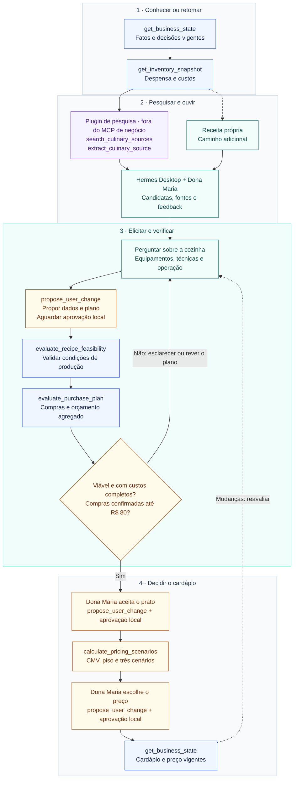
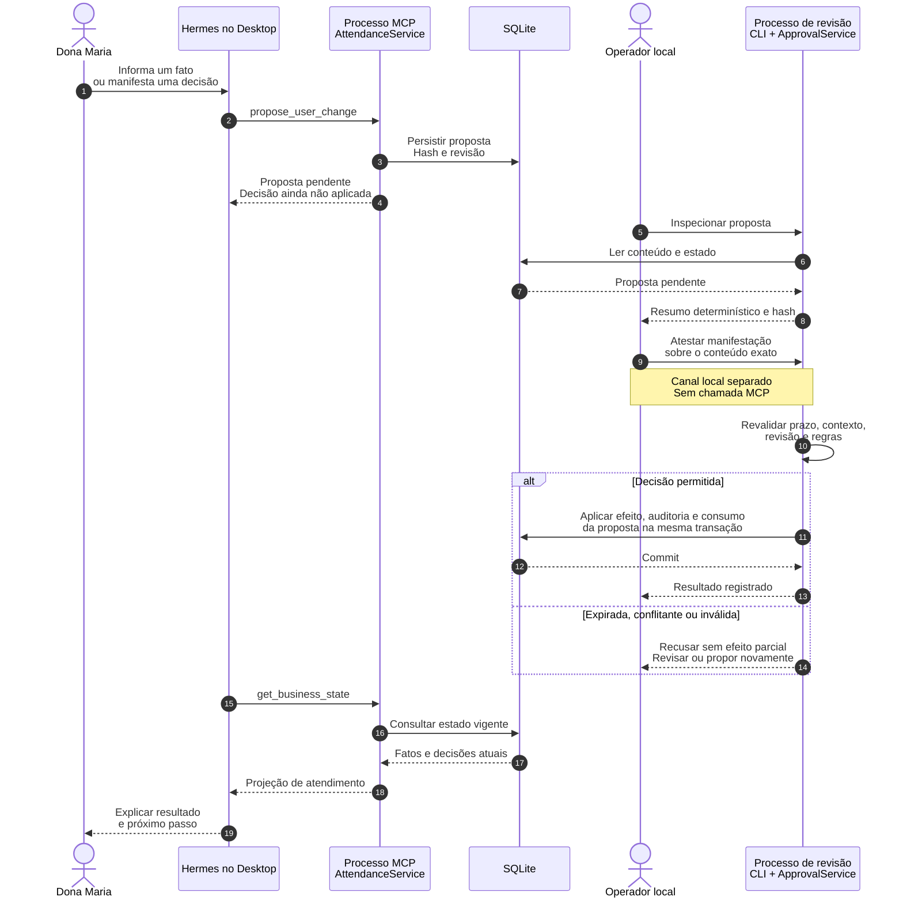

<a id="topo"></a>
<div align="center">

<h1>🍲 Sabor da Maria</h1>

<p><strong>Da despensa ao cardápio. Da conversa a uma decisão com números.</strong></p>
<p>Consultora conversacional de cardápio e precificação com Hermes Agent e Python.</p>
<p>Desafio técnico · Senior AI Engineer · iFood</p>

<p>
<a href="https://github.com/NousResearch/hermes-agent"></a>
<a href="https://www.python.org/"></a>
<a href="https://modelcontextprotocol.io/"></a>
<a href="https://docs.pydantic.dev/"></a>
<a href="https://www.sqlite.org/"></a>
</p>
<p><a href="LICENSE"></a></p>
<p><a href="#desafio">Conheça o desafio</a> · <a href="#executar">Execute o projeto</a> · <a href="#validar">Valide o código</a> · <a href="#sobre-mim">Sobre mim</a></p>
</div>

---

## 📑 Sumário

- [O desafio e a solução](#desafio)
- [Execute localmente com sua planilha e seu modelo](#executar)
  - [Pré-requisitos e versão do Hermes](#requisitos)
  - [Instalação e planilha real](#instalacao-local)
  - [Perfil, pesquisa e modelo](#configuracao-local)
  - [Desktop, aprovação e retomada](#desktop-local)
- [Teste a jornada completa](#jornada-real)
- [Acompanhe o fluxo do agente](#experiencia)
- [Entenda a arquitetura](#arquitetura)
- [Da planilha ao preço](#precificacao)
- [Verifique a implementação](#validar)
- [Resolva problemas de execução](#problemas)
- [Segurança e limites](#seguranca)
- [Explore o repositório](#estrutura)
- [Sobre mim](#sobre-mim)

<a id="desafio"></a>
## 🧭 O desafio e a solução

Dona Maria está abrindo seu primeiro delivery. Ela conhece a despensa e quanto pagou pelos ingredientes, mas precisa decidir **o que consegue produzir e quanto cobrar**. O desafio pede customizar o Hermes Agent para pesquisar receitas reais, descobrir restrições na conversa e acompanhá-la até a escolha do preço.

O Sabor da Maria combina **Hermes para conversar e pesquisar** com **Python/MCP para validar condições, orçamento e cálculos**. A entrada é `despensa_dona_maria.xlsx`, com as abas `Despensa` e `Precos`. O planejamento considera **R$ 80,00 para complementos** e **taxa de 10% sobre a venda**, conforme o enunciado.

**O centro da solução é a elicitação:** gostar de uma receita não significa conseguir prepará-la. Antes do aceite, a consultora precisa esclarecer equipamentos, habilidades, tempo, gás/energia, espaço e ingredientes na quantidade planejada. Uma condição desconhecida gera uma pergunta; uma condição impeditiva exige rever o plano.

| Requisito do desafio | Como foi implementado | Onde conferir |
| --- | --- | --- |
| Pesquisar receitas reais e pedir feedback | Pesquisa e extração mediadas, fontes registradas e distinção entre interesse e aceite | [Pesquisa real e controles](evals/s19-results.json) |
| Descobrir restrições antes do aceite | Perguntas orientadas à receita e validação de condições na escala do plano | [Skill de atendimento](skills/dona-maria-cardapio/SKILL.md), [testes de aceite](tests/unit/test_acceptance.py) |
| Comparar despensa e faltantes dentro do orçamento | Estoque e compras agregados entre pratos; pacotes, encargos e confirmações de ofertas | [Testes do plano compartilhado](tests/unit/test_shared_plan.py) |
| Explicar CMV, propor cenários e deixar a escolha com Dona Maria | Custos por origem, três margens e preço personalizado; cálculo e escolha separados | [Testes financeiros](tests/unit/test_pricing.py), [aprovação local](tests/unit/test_local_approval.py) |
| Entregar Hermes customizado e decisões justificadas | Orientações, skill, plugins, MCP local e configuração reproduzível | [Arquitetura](#arquitetura), [guia de instalação](docs/setup.md) |

> [!IMPORTANT]
> Há testes determinísticos e registros de jornadas assistidas com Hermes e pesquisa real. Essas evidências têm versões e limites próprios: não representam homologação automática de toda alteração posterior. O planejamento não efetua compras, pagamentos ou consumo de estoque físico. Consulte o [estado das verificações](#validar).

<a id="preparacao"></a>
<a id="executar"></a>
## 🚀 Execute localmente com sua planilha e seu modelo

Este é o percurso completo para o avaliador: **XLSX real → seu modelo no Hermes → pesquisa web → conversa no Desktop → aprovação local → cardápio e preço**. Não usa dados de demonstração, respostas gravadas ou credenciais da autora. Tenha dois canais: o Desktop para conversar e um terminal para revisar propostas.

> [!IMPORTANT]
> O plugin de pesquisa suporta **Hermes 0.23.1, commit `3b421578588243f920886e6fe79a6faa87ea026e`**. O lock Python não fixa o Hermes. Outra versão é recusada pelo plugin até validação de compatibilidade; instalar simplesmente a versão mais recente não garante funcionamento. O percurso Desktop está implementado, mas sua homologação conversacional nesta revisão permanece pendente. Veja [verificações](#validar).

<a id="requisitos"></a>
### 1. Confira os pré-requisitos

| Requisito | Para que serve / como obter |
| --- | --- |
| [Git](https://git-scm.com/downloads) | Clonar este repositório. |
| [uv](https://docs.astral.sh/uv/getting-started/installation/) | Instalar Python 3.13 e as dependências fixadas no lock. Não precisa ativar uma virtualenv. |
| [Hermes com Desktop](https://hermes-agent.nousresearch.com/docs/user-guide/desktop) | Host do agente; deve estar disponível como `hermes` no terminal e usar a versão acima. |
| Modelo com chamadas de ferramentas | Você escolhe o provedor/modelo e autentica no seu Hermes. Pode ser remoto ou local quando suportado pelo host; nem todo modelo foi testado. |
| Planilha real e acesso à internet | A planilha é sua entrada; a internet é usada na instalação e pesquisa de receitas. |

No terminal, confira `git --version`, `uv --version` e `hermes --version`. Caso ainda não tenha Hermes, use a [instalação da versão compatível](docs/setup.md#dependencias). Não substitua uma instalação pessoal para seguir o tutorial. Custos e autenticação do modelo dependem do provedor escolhido; **o modelo e o provedor de pesquisa são configurações diferentes**.

<a id="instalacao-local"></a>
### 2. Clone e instale o ambiente da aplicação

No PowerShell, bash ou zsh:

```sh
git clone https://github.com/glaucia86/sabor-da-maria-hermes-agent.git
cd sabor-da-maria-hermes-agent
uv sync --locked --python 3.13
```

**Esperado:** ambiente `.venv` criado e dependências instaladas. Todos os comandos seguintes partem desta pasta. O runtime Python do Hermes é separado; não instale as dependências da aplicação nele. Não é necessário Docker.

### 3. Coloque sua planilha no diretório privado

```sh
uv run --locked --no-sync python -c "from pathlib import Path; Path('artifacts/private/input').mkdir(parents=True, exist_ok=True)"
```

Copie `despensa_dona_maria.xlsx`, recebido pelo canal do desafio, para `artifacts/private/input/`. **O arquivo original não acompanha o repositório.** Você também pode usar outra planilha real com estas abas e cabeçalhos exatos:

| Aba | Cabeçalhos, na ordem |
| --- | --- |
| `Despensa` | `Ingrediente`, `Quantidade em estoque`, `Unidade` |
| `Precos` | `Ingrediente`, `Quantidade comprada`, `Unidade`, `Preço total pago (R$)` |

Confira que o arquivo está protegido do versionamento:

```sh
git check-ignore artifacts/private/input/despensa_dona_maria.xlsx
```

**Esperado:** o comando imprime esse caminho. O importador lê o arquivo, preserva o original e aponta dados ausentes ou ambíguos. Não preencha lacunas com valores arbitrários. Os formatos de embalagem são explicados em [Da planilha ao preço](#precificacao).

### 4. Prepare o atendimento REAL

```sh
uv run --locked --no-sync python -X utf8 -m dona_maria.onboarding setup-real --inventory "artifacts/private/input/despensa_dona_maria.xlsx" --directory "artifacts/private/local"
uv run --locked --no-sync python -X utf8 -m dona_maria.onboarding check --directory "artifacts/private/local"
```

**Esperado:** `context_mode: REAL`, inventário importado com custos/diagnósticos, orçamento inicial de `80.00`, `mcp: PASS` e zero decisões humanas aprovadas. O primeiro comando cria a cópia da planilha, SQLite, backups das migrações e manifesto local. O segundo confere as seis ferramentas MCP e a recusa de uma ferramenta proibida, sem usar LLM.

Use **o mesmo `--directory` em todas as etapas**. Repetir `setup-real` com o mesmo arquivo preserva o atendimento; outro arquivo ou contexto exige outra pasta. Não edite o manifesto ou reutilize um banco de simulação. Os identificadores são vinculados automaticamente; você não precisa copiá-los para a conversa.

<a id="configuracao-local"></a>
### 5. Prepare a pesquisa e o perfil do projeto

O percurso guiado usa **DDGS**, sem chave de API de pesquisa e sem fallback automático. Na instalação Hermes compatível, instale seu componente opcional se ainda estiver ausente:

```sh
hermes tools post-setup ddgs
```

Esse comando prepara dependências **do Hermes**, compartilhadas pela instalação; não configura seu modelo. Se já havia processos do Hermes abertos, encerre-os normalmente e reabra após a instalação. Não é necessário instalar um serviço de gateway para seguir este guia.

```sh
uv run --locked --no-sync python -X utf8 -m dona_maria.onboarding configure --directory "artifacts/private/local"
```

Informe ingredientes/pratos públicos separados por vírgulas, por exemplo `arroz, feijão, frango`. Confira a lista exibida e digite `LIBERAR PESQUISA` somente se concordar. Apenas esses termos podem compor consultas de receitas ou ofertas; quantidades, preços históricos e a planilha inteira não são enviados pelo plugin. Para ampliar os termos posteriormente, siga a [reconfiguração de pesquisa](docs/setup.md#pesquisa).

**Esperado:** `configured: true`, nome de perfil `sabor-real-…` e `research: CONFIGURED_NOT_EXERCISED`. O comando cria um perfil vazio e vincula MCP, política, pesquisa e skill. Não copia credenciais pessoais. O nome é mostrado para você conferir no Desktop; não precisa digitá-lo nos comandos deste projeto.

### 6. Escolha seu modelo e autentique

```sh
uv run --locked --no-sync python -X utf8 -m dona_maria.onboarding model --directory "artifacts/private/local"
```

No seletor do **seu Hermes**, escolha provedor e modelo com suporte a ferramentas, e conclua a autenticação solicitada. Para modelo local, informe a configuração de conexão suportada pelo Hermes e mantenha seu servidor disponível. Nenhum modelo da autora é imposto pelo projeto; não cole chaves no chat, na planilha ou no repositório.

**Esperado:** seleção salva no perfil exclusivo. Para trocar de modelo depois, repita este comando, verifique o perfil e inicie uma nova conversa. A qualidade da elicitação pode variar por modelo; registre qual você avaliou.

### 7. Verifique a preparação

```sh
uv run --locked --no-sync python -X utf8 -m dona_maria.onboarding verify-profile --directory "artifacts/private/local"
```

**Esperado:** configuração, arquivos dos plugins, descoberta da skill e conexão MCP em `PASS`, além de `model_configured: true`. `credentials: NOT_CHECKED` e `host_dispatch_and_conversation: NOT_RUN` são intencionais: o diagnóstico não envia uma mensagem ao modelo nem comprova a pesquisa. Essa prova acontece na próxima etapa.

<a id="desktop-local"></a>
### 8. Abra o Desktop e inicie o atendimento

```sh
uv run --locked --no-sync python -X utf8 -m dona_maria.onboarding desktop --directory "artifacts/private/local"
```

O comando repete a verificação e abre `hermes -p <perfil preparado> desktop --cwd <contexto preparado>`. Em uma instalação por código-fonte, o primeiro lançamento pode preparar os componentes do Desktop. Confira na interface o perfil `sabor-real-…` mostrado pelo diagnóstico e mantenha o diretório de conversa preparado; não selecione o checkout como projeto.

Inicie uma conversa, por exemplo:

> Quero planejar meu cardápio de lançamento. Consulte minha despensa e pesquise receitas reais que aproveitem os ingredientes. Tenho R$ 80 para complementos. Antes de aceitar um prato, me ajude a conferir se consigo prepará-lo.

**Esperado:** consulta da despensa importada, pesquisa com fontes e perguntas sobre preferências e condições reais. Informe seus equipamentos, habilidades e limitações; não confirme um cenário fictício só para avançar. Na inspeção técnica do host, confira seis ferramentas MCP e duas de pesquisa. Se uma delas não estiver disponível, resolva a configuração antes de considerar o desafio completo.

### 9. Revise as propostas no segundo terminal

Quando o agente criar uma proposta, abra outro terminal na raiz do repositório:

```sh
uv run --locked --no-sync python -X utf8 -m dona_maria.onboarding review --directory "artifacts/private/local" list
uv run --locked --no-sync python -X utf8 -m dona_maria.onboarding review --directory "artifacts/private/local" inspect ID_DA_PROPOSTA
uv run --locked --no-sync python -X utf8 -m dona_maria.onboarding review --directory "artifacts/private/local" approve ID_DA_PROPOSTA --hash HASH_DA_INSPECAO
```

Substitua `ID_DA_PROPOSTA` pelo identificador retornado por `list` e `HASH_DA_INSPECAO` pelo hash de `inspect`. Leia o resumo. Somente se ele corresponder ao que você realmente informou/decidiu, digite **`ATESTO ` seguido do hash** no terminal. Para recusar, use `reject ID_DA_PROPOSTA --hash HASH_DA_INSPECAO` no lugar de `approve`.

Esse procedimento se repete nas mudanças que dependem de confirmação: receita, fatos, plano, aceite e escolha do preço. Volte ao Desktop e peça para consultar o estado atualizado. O agente não pode aprovar por você. Se você representar cozinheira e operador, deixe esses dois papéis explícitos. Propostas expiram em dez minutos; conteúdo ou estado alterado exige nova revisão.

### 10. Retome sem reimportar

Feche a interface normalmente. Para continuar, repita o comando `desktop` da etapa 8, confira o mesmo perfil e retome a sessão ou abra outra conversa pedindo o estado atual do cardápio. As decisões persistem no SQLite, independentemente do histórico do LLM. **Não execute outra importação para retomar.**

<a id="jornada-real"></a>
## 🧑‍🍳 Teste a jornada completa

| Etapa | O que observar |
| --- | --- |
| Pesquisa | Receitas com fontes reais, usando os termos liberados; falha de rede não vira fonte inventada. |
| Feedback e elicitação | Gostar do prato não equivale a aceitá-lo. O agente pergunta sobre equipamentos, técnicas, tempo, energia e armazenamento necessários. |
| Ingredientes | Compara quantidades com sua despensa, esclarece unidades e custos ausentes e verifica complementos dentro dos R$ 80 agregados. |
| Aceite | Requisito desconhecido ou impeditivo mantém a decisão pendente/bloqueada. Aprovação local só aplica uma decisão válida. |
| Precificação | Após aceite válido, explica CMV, taxa de 10% e três cenários. Você escolhe o preço; o modelo não decide. |
| Retomada | Mantém fatos e escolhas vigentes; selecionar um prato não consome estoque físico nem efetua compras. |

Não é necessário provocar todos os erros para concluir uma jornada. Para avaliação técnica, teste também a falta real de um equipamento, uma quantidade ambígua e uma mudança de premissa. Os resultados esperados são perguntas, bloqueios ou revalidação, nunca preenchimento inventado.

O [guia de recuperação](docs/setup.md), o [roteiro de 5–10 minutos](docs/speaker/demo-hermes.md) e a [apresentação técnica](docs/speaker/README.md) complementam este percurso. Testes automatizados com fixtures sintéticas ficam em [Verifique a implementação](#validar); não substituem esta avaliação com seus dados.

<a id="experiencia"></a>
## 💬 Acompanhe o fluxo do agente

O diagrama mostra uma **jornada típica com retornos**, não uma sequência fixa imposta ao modelo. O Hermes reutiliza fatos vigentes e pergunta somente o que falta para a candidata e a quantidade em discussão. As chamadas e referências técnicas ficam na camada de ferramentas; Dona Maria conversa em linguagem natural.



**Exemplo ilustrativo:** se Dona Maria gosta de uma receita assada, a consultora pergunta se há forno e capacidade para o lote. Ter forno ainda não confirma técnica, tempo disponível ou armazenamento. Se uma condição muda, as decisões dependentes são reavaliadas; o histórico é preservado.

### As seis tools MCP de atendimento

O catálogo está definido em [`ATTENDANCE_TOOLS`](src/dona_maria/business_state.py) e é conferido em [integração stdio](tests/integration/test_attendance_stdio.py). Banco, workspace e modo são configurados pelo operador; o modelo não escolhe outro contexto por argumento.

| Tool | Quando o agente usa | Efeito |
| --- | --- | --- |
| `get_business_state` | Ao iniciar, retomar ou conferir uma alteração | Consulta fatos, pendências, propostas e decisões vigentes. |
| `get_inventory_snapshot` | Ao comparar uma receita com a despensa | Consulta ingredientes, quantidades, custos e diagnósticos. |
| `evaluate_recipe_feasibility` | Ao verificar se a receita cabe nas condições da cozinha | Avalia os requisitos no plano atual, sem aceitar o prato. |
| `evaluate_purchase_plan` | Ao consolidar complementos de todos os pratos | Avalia demanda, pacotes, desembolso e lacunas, sem comprar. |
| `propose_user_change` | Ao registrar receita, fatos ou uma decisão manifestada | Persiste proposta para revisão local; não aplica a decisão de negócio. |
| `calculate_pricing_scenarios` | Depois de um aceite local vigente | Persiste o cálculo e os cenários; não escolhe preço. |

As quatro primeiras tools são consultas. As duas últimas gravam, respectivamente, proposta e cálculo. `accept_recipe`, `save_menu_decision`, `register_complement_quote`, `set_production_plan` e `confirm_complement_quote` são **comandos internos encaminhados por propostas**, não ferramentas adicionais disponíveis ao modelo.

O plugin acrescenta duas capacidades separadas: `search_culinary_sources` pesquisa receitas ou ofertas com termos previamente liberados; `extract_culinary_source` extrai um resultado registrado pelo identificador. Não aceita consulta ou URL livre do modelo. Fontes novas exigem configuração e homologação do perfil; conteúdo recuperado continua sendo dado não confiável.

**Contagem por contexto:** o atendimento usa **6 tools MCP + 2 tools do plugin de pesquisa**. O construtor legado `create_server` oferece 16 ferramentas para testes/integrações locais; não é o launcher do atendimento. Há sobreposição de nomes entre os catálogos: somá-los não representa as permissões do agente. A aprovação local não pertence a nenhum catálogo do modelo.

<a id="arquitetura"></a>
## 🏗️ Entenda a arquitetura

**O Hermes conduz a interação; o serviço Python verifica o que pode virar estado de negócio.** O adaptador MCP expõe contratos restritos via stdio. Os serviços de domínio validam disponibilidade, condições, orçamento e preço; o repositório SQLite persiste estado, histórico e auditoria.

### Como uma proposta vira uma decisão aprovada

A manifestação de Dona Maria e a atestação do operador têm papéis distintos. O operador revisa o conteúdo exato e atesta que ela tomou aquela decisão; não decide por ela. Essa etapa ocorre no terminal em outro processo, sem ferramenta de aprovação acessível ao agente. É uma decisão arquitetural deste projeto, não uma interface adicional exigida pelo enunciado. Uma pessoa pode exercer ambos os papéis durante a avaliação.

Este é um **diagrama de sequência**, não uma máquina de estados. O terminal chama diretamente `ApprovalService` em Python; não envia uma requisição MCP. O processo MCP e o processo de revisão usam o mesmo SQLite e reutilizam código de domínio, sem compartilhar uma instância em memória.



Não há transação aberta enquanto se espera a pessoa. Propostas expiram em dez minutos; mudanças de estado exigem nova revisão. Replay idempotente não duplica efeitos e um resultado histórico não restaura aprovação vigente. Resposta perdida pede consulta do estado antes de anunciar sucesso ou repetir uma decisão.

### Escolhas e consequências

| Decisão | Justificativa e limite |
| --- | --- |
| **Hermes customizado, com Desktop para a avaliação** | Reutiliza o host exigido pelo desafio. Perfil exclusivo, skill incorporada ao contexto preparado e plugins limitam o atendimento. CLI permanece como canal do operador; a homologação do Desktop é independente dos testes MCP. |
| **Modelo escolhido pelo avaliador** | Configuração pelo seletor nativo do Hermes; requer chamadas de ferramentas. Favorece reprodução com acesso próprio, mas qualidade da conversa e compatibilidade variam e precisam ser observadas por modelo. |
| **MCP local via stdio** | Contratos explícitos e sem servidor HTTP adicional. O serviço atende um contexto vinculado pelo operador, sem autenticação remota multiusuário. |
| **Python separado do runtime Hermes** | Regras e testes podem ser executados sem chamadas de LLM. Exige configurar o ambiente da aplicação e o host separadamente. |
| **Pydantic e Decimal** | Payloads tipados, campos extras recusados e aritmética financeira com 34 dígitos. Validação estrutural não comprova a veracidade de um fato informado. |
| **SQLite e auditoria transacional** | Persistência local, retomada e idempotência sem infraestrutura de banco externa. Histórico é preservado; a vigência é reavaliada quando premissas mudam. |
| **Aprovação local exata** | O modelo propõe; uma entrada fora de seu catálogo autoriza o efeito. É uma experiência assistida com trabalho operacional adicional, não autenticação forte da cozinheira. |
| **Pesquisa mediada** | Termos liberados, resultados registrados e controles de rede limitam a superfície de acesso externo. O adaptador depende da versão homologada do host e recusa incompatibilidades. |

**Context files e skill.** [`.hermes.md`](.hermes.md) define papel, linguagem e limites da consultora. A [skill de domínio](skills/dona-maria-cardapio/SKILL.md) orienta pesquisa, elicitação, propostas e apresentação dos números. O plugin de política restringe capacidades no host; validações e autorização ficam no Python. Instruções ao LLM não substituem esses controles. `AGENTS.md` orienta desenvolvimento e não é o contexto de atendimento da demo.

**Memória.** O [perfil de referência](config/hermes.config.example.yaml) desabilita memória automática e perfil de usuário do Hermes. O histórico conversacional ajuda a interação, mas fatos, preferências, receitas, plano, aceites e preços são recuperados do SQLite por `get_business_state`. Uma nova sessão pode retomar o negócio sem confiar na lembrança do modelo.

**Modelo.** A [verificação histórica](docs/verification.md) registra `openai/gpt-6.1-sol` no Hermes 0.23.1. É uma configuração observada, não um vencedor de benchmark nem uma dependência fixada pelo lock Python. A escolha operacional requer chamadas de ferramentas, seguimento das instruções em português e avaliação da jornada completa. Outro modelo precisa passar pelos mesmos evals; não há comparação publicada de qualidade, latência e custo entre modelos. Provedor e credenciais ficam no perfil privado do Hermes, separados do processo de negócio.

### Capacidades além do percurso básico

| Capacidade entregue | Comportamento preservado |
| --- | --- |
| Receitas próprias e adaptações | Informação humana pode entrar sem URL; origem por campo e versões anteriores são preservadas. Adaptação não herda automaticamente o aceite. |
| Medidas e identidades | Esclarecimentos têm evidência e escopo por ingrediente/contexto. Medição reportada não comprova calibração; alterar medida de receita não reescreve a compra histórica. |
| Vários pratos | Demanda, estoque, pacotes e gastos são compartilhados. A produção suportada é sequencial e exige confirmar capacidade e tempo; reordenar ou mudar escala exige revalidação. |
| Custos incompletos e recursos externos | Estoque disponível sem custo de aquisição continua disponível, mas bloqueia aceite e preço definitivos. Aquisições reportadas preservam a planilha e passam por aprovação local. |
| Correções e retomada | Mudanças materiais invalidam dependentes. Recusa ou preferência `AVOID` incompatível retira o prato do plano; `LIKE` não confirma aptidão. A correspondência automática de preferências é literal. |
| Demonstração identificada | Contextos `REAL` e `SIMULATION` são imutáveis por banco. Dependências fictícias e completude são indicadas separadamente e preservadas na retomada. |

<a id="precificacao"></a>
## 🧮 Da planilha ao preço

### Estoque e custo têm denominadores diferentes

O importador cruza os ingredientes das abas `Despensa` e `Precos`, preservando origem por célula e apontando ambiguidades. **Quantidade em estoque determina disponibilidade; quantidade comprada determina custo unitário.** Quantidades, preços ou conversões ausentes não viram zero.

| Dado de entrada | Tratamento |
| --- | --- |
| Arroz: compra de 5 kg por R$ 24,90 | `24,90 / 5.000 = R$ 0,00498/g`. Um uso hipotético de 100 g custa R$ 0,498 antes da apresentação em centavos. |
| Alcaparras: 1 `balde 2kg` | A embalagem informa 2.000 g; o custo usa essa quantidade comprada. |
| Embalagens `un 500g`, `un 400g`, `un 500ml`, `un 100ml` | Conversões explícitas são normalizadas para gramas ou mililitros. |
| Cobertura de chocolate: 1 `un` | Não há peso informado. Se a receita exigir gramas, é necessário esclarecer a conversão. |

Os exemplos usam os dados do enunciado, não uma receita real executada. Reduzir o estoque não muda o denominador da compra histórica. Água incorporada à receita compõe o CMV; água de limpeza declarada como recurso externo fica separada.

### Complementos: desembolso e consumo

O plano agrega os faltantes de **todos os pratos**. O limite inclusivo de R$ 80 considera pacotes inteiros e encargos; o CMV considera o ingrediente consumido, com custo separado por origem. Estoque histórico é alocado primeiro e complementos cobrem o excedente, sem duplicar pacotes ou gastos entre pratos.

Preço, conteúdo da embalagem, frete ou disponibilidade desconhecidos mantêm a oferta pendente. Selecionar uma oferta não a confirma. A confirmação humana vale até o menor prazo entre 24 horas da manifestação e o vencimento da oferta; expiração ou mudança invalida decisões dependentes, inclusive na retomada. Confirmar premissas não efetua compra, e aceitar o cardápio não reduz estoque físico nem o orçamento inicial.

### CMV, taxa e cenários

Para a unidade de venda definida pela receita, o serviço calcula o custo por porção a partir do consumo do lote e do rendimento:

```text
custo unitário = preço total pago / quantidade comprada
CMV do lote = soma(quantidade usada × custo unitário), por origem
CMV por porção = CMV do lote / rendimento do lote
recebimento após taxa = 0,90 × preço de venda
resultado após taxa e ingredientes = 0,90 × preço de venda − CMV por porção
preço mínimo = CMV por porção / 0,90
preço para margem m sobre a venda = CMV por porção / (0,90 − m)
```

O preço é arredondado **para cima em centavos** para sustentar o piso ou a margem proposta. Margem sobre venda não é acréscimo percentual sobre custo. Os três cenários de 10%, 20% e 30% são uma escolha da implementação; o enunciado pede dois ou três cenários, sem fixar essas margens.

Exemplo sintético com **CMV de R$ 10,00 por porção**, conferido nos testes:

| Opção | Preço de venda | Taxa exibida | Sobra após taxa e ingredientes |
| --- | --- | --- | --- |
| Piso, sem margem-alvo | R$ 11,12 | R$ 1,11 | R$ 0,01 |
| Margem-alvo de 10% | R$ 12,50 | R$ 1,25 | R$ 1,25 |
| Margem-alvo de 20% | R$ 14,29 | R$ 1,43 | R$ 2,86 |
| Margem-alvo de 30% | R$ 16,67 | R$ 1,67 | R$ 5,00 |

Taxa e sobra exibidas seguem a política didática de centavos; a validação mantém os valores técnicos em `Decimal`. A taxa de 10% é a premissa do desafio, não uma afirmação sobre repasse comercial real do iFood.

O enunciado chama `0,90 × P − CMV` de lucro. Aqui o atendimento explica esse valor como **sobra após ingredientes e taxa**: embalagem, gás/energia, trabalho e outros custos precisam de dados próprios para estimar lucro líquido. Dona Maria escolhe um cenário ou um preço personalizado em centavos, respeitando o mínimo; a escolha exige proposta e aprovação local.

<a id="validar"></a>
## ✅ Verifique a implementação

Após instalar as dependências, execute na raiz:

```sh
uv run --locked --no-sync python -X utf8 -B -m pytest tests/unit tests/integration -q
uv run --locked --no-sync ruff check src tests/conftest.py tests/unit tests/integration evals scripts
uv run --locked --no-sync ruff format --check src tests/conftest.py tests/unit tests/integration evals scripts
```

Os testes usam fixtures sintéticas e SQLite temporário. Cobrem importação, custos, condições desconhecidas ou bloqueadas, orçamento agregado, aprovação, concorrência, rollback, replay, invalidação e retomada. Integrações exercitam MCP stdio real; testes com Hypothesis exploram sequências de alterações. O [teste do anexo original](docs/setup.md#teste-do-original) é ignorado quando o arquivo privado está ausente.

### O que as evidências demonstram

| Evidência registrada | Alcance e limite |
| --- | --- |
| [Percurso local REAL e Desktop](docs/speaker/verification-local-real.md) | Regressão: 804 testes aprovados e dois ignorados; 15 testes do onboarding passaram após o refinamento final do guard de versão. Diagramas, links e slides conferidos. Lint geral tem quatro imports preexistentes não usados; Desktop com modelo autenticado e planilha original ainda não foi homologado. |
| [Verificação integrada histórica](docs/verification.md) e [12 evals originais](evals/s11-results.json) | Jornada assistida, pesquisa real, decisões e retomada em dados sintéticos. Assertions críticas originais passaram; revisão humana apontou clareza insuficiente em EV-07 e EV-09. As respostas reais corrigidas passaram na revisão delegada em S19; a avaliação humana original permanece registrada, sem alegar nova entrevista humana de usabilidade. |
| [Pesquisa mediada — handoff S17](doc-specs/implementation-slices.md) | Registro de pesquisa/extração reais de receitas e ofertas, recusas no host e encerramento da revisão humana no perfil testado. O relatório separado S17 não acompanha este checkout; seu handoff histórico foi preservado. Não homologa automaticamente outro perfil ou versão. |
| [Onboarding e apresentação](docs/speaker/verification-s20.md) | Registro anterior de 795 testes aprovados e dois ignorados, preflight e MCP conferidos. Perfil novo sem modelo; não houve conversa LLM nessa etapa. Os skips foram anexo original ausente e symlink indisponível no Windows. |
| [CI](.github/workflows/ci.yml) | Configura checks de núcleo/MCP em Windows, Ubuntu e macOS. Não instala o Hermes nem testa a conversa. Sucesso histórico não comprova a execução de uma alteração posterior. |
| [Agent Evals](evals/README.md) e [matriz S19](evals/s19-results.json) | 18 casos integrados concluídos no recorte CLI assistido, com versões executadas, falhas e revisão automatizada explicitamente delegada preservadas. Os 12 roteiros anteriores permanecem históricos. Não são 18 novas execuções da mesma versão nem homologação Desktop. |

**Estado da versão documentada:** o percurso REAL prepara banco, perfil, pesquisa e abertura do Desktop; a jornada humana completa nesse canal ainda precisa ser validada com planilha original e modelo autenticado. Resultados históricos e `NOT_RUN` mantêm seu alcance. Consulte o [registro desta revisão](docs/speaker/verification-local-real.md) para distinguir os testes atuais das evidências anteriores.

A avaliação completa precisa conferir conversa acessível, pesquisa real, decisões, retomada e estado persistido na mesma versão/perfil. **Desktop é o canal escolhido para a avaliação; os resultados históricos em CLI não o homologam.** A demonstração é feita ao vivo; slides e roteiro não substituem um ensaio concluído.

Testes com fixtures não comprovam pesquisa real nem a qualidade da conversa.
Os evals assistidos não comprovam autonomia geral nem autenticam consentimento
humano. A matriz S19 preserva tentativas com falha e o alcance histórico das
versões executadas. A [verificação integrada](docs/verification.md) registra a
reprodução em ambiente limpo, a jornada com complemento pesquisado e a matriz
dos 22 critérios. A CI histórica de núcleo/MCP passou em Windows, Linux e macOS;
Desktop e vídeo não foram testados naquela execução.

### Teste básico opcional sem modelo

Para verificar somente o núcleo com uma fixture sintética, use `python scripts/demo.py setup` e depois `uv run --locked --no-sync python -X utf8 scripts/demo.py check`. Esse fluxo é `SIMULATION`, contém somente arroz e não habilita pesquisa. Ele permanece separado do [percurso real do avaliador](#executar).

<a id="problemas"></a>
## 🛠️ Resolva problemas de execução

| Sintoma | Próximo passo |
| --- | --- |
| `hermes` ou `uv` não encontrado | Reabra o terminal após instalar e confira o PATH. |
| Planilha ausente/inválida | Confira caminho entre aspas, abas, cabeçalhos e limite de 5 MiB. A aplicação não gera uma substituta. |
| Outra planilha/contexto ou pasta incompleta | Preserve a pasta; escolha outro `--directory`. Não edite manifesto ou banco. |
| Modelo ausente ou falha de autenticação | Repita `model` no mesmo diretório; autentique localmente. `model_configured` não prova credenciais válidas. |
| Pesquisa incompatível/indisponível | Confira versão/commit do Hermes, componente DDGS, termos liberados e rede. Não habilite busca livre como fallback. |
| Termo desejado não foi liberado | Siga [como revisar termos](docs/setup.md#pesquisa); não peça ao modelo para contornar a restrição. |
| Desktop mostra outro perfil ou ferramentas extras | Interrompa o atendimento e confira perfil/contexto. O catálogo esperado é seis MCP e duas de pesquisa. |
| Proposta expirada ou hash divergente | Consulte novamente o estado; peça uma proposta atual e faça nova inspeção. |
| Modelo afirma que salvou, mas o estado não mudou | Confira a revisão local e consulte `get_business_state`; texto do modelo não prova persistência. |

Para recuperação, compatibilidade e importação manual, consulte o [guia operacional](docs/setup.md).

<a id="seguranca"></a>
## 🔒 Segurança e limites

- Conteúdo web, células da planilha e mensagens são dados não confiáveis; não concedem autorização nem alteram orçamento, taxa ou capacidades.
- Aprovação local confere conteúdo exato, prazo e estado. Uma identidade `USER` enviada pelo modelo não autentica consentimento. O perfil restringe capacidades, mas não é sandbox contra código executado na mesma conta do sistema.
- Consultas usam conexões somente leitura; alterações usam SQL parametrizado e transações com auditoria. Projeções de atendimento omitem caminhos, payloads privados e exceções internas; logs técnicos ficam no contexto do operador.
- O importador recusa arquivos fora da raiz autorizada, XLSX acima de 5 MiB, expansão ZIP acima de 50 MiB e mais de 20.000 linhas, sem aceitar snapshot parcial.
- Bancos, planilha original, credenciais, logs privados e transcrições pessoais ficam fora do Git. Importações e migrações são operações locais do operador.
- Confirmações registram premissas informadas, sem comprovar capacidade física, segurança alimentar ou operação de delivery. A solução não compra, paga ou consome estoque físico.

<a id="estrutura"></a>
## 🗂️ Explore o repositório

```text
.hermes.md                         Papel, comunicação e limites do atendimento
AGENTS.md                          Convenções de engenharia
config/                           Exemplos de configuração sem segredos
skills/dona-maria-cardapio/         Procedimentos da consultora
src/dona_maria/                    Domínio, persistência, MCP e plugins Hermes
src/dona_maria/onboarding.py        Preparação REAL, perfil, modelo e Desktop
scripts/demo.py                    Onboarding portátil e demo sintética
tests/unit/ e tests/integration/   Regras e integrações com dados sintéticos
evals/                            Roteiros e evidências de avaliação do agente
docs/setup.md                      Instalação, perfis, aprovação e recuperação
docs/speaker/                      Slides, guia técnico e roteiro de demo
pyproject.toml e uv.lock           Dependências e ferramentas da aplicação
```

Este projeto é independente e foi desenvolvido para um desafio técnico. O Hermes Agent pertence à Nous Research; nomes e marcas de terceiros pertencem aos respectivos titulares. O código deste repositório segue a [licença MIT](LICENSE).

---


<a id="sobre-mim"></a>
## 👩🏽‍💻 Sobre mim

<div align="center">
<a href="https://github.com/glaucia86"></a>

<h3>Glaucia Lemos</h3>
<p><strong>Software Engineer · AI Engineer · Educadora · Codex Ambassador</strong></p>
<p>Sou engenheira de software e compartilho conhecimento sobre JavaScript, TypeScript,<br>Node.js e Inteligência Artificial. Meu trabalho conecta desenvolvimento de aplicações,<br>IA generativa e aprendizado prático em comunidades e projetos open source.</p>

<p>
<a href="https://www.youtube.com/user/l32759"></a>
<a href="https://www.linkedin.com/in/glaucialemos/"></a>
<a href="https://github.com/glaucia86"></a>
</p>
<p><a href="#topo">↑ Voltar ao topo</a></p>
</div>
