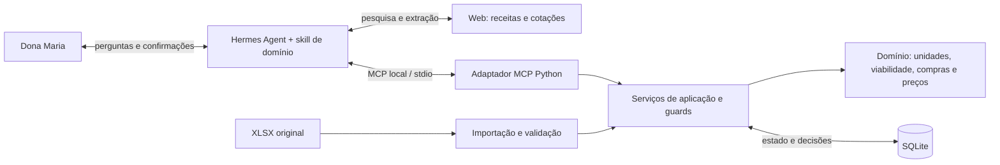

# Sabor da Maria

**Da despensa ao cardápio: receitas reais, produção viável e preços explicáveis.**

Projeto para o desafio técnico **Senior AI Engineer do iFood**, com customização do **[Hermes Agent](https://github.com/NousResearch/hermes-agent)**, da Nous Research. A proposta é acompanhar Dona Maria no lançamento do seu delivery: pesquisar receitas, descobrir restrições da cozinha, planejar ingredientes e ajudá-la a escolher quanto cobrar.

> **Status: preparação documental; implementação da aplicação não iniciada.**
> Há orientações de projeto e um plano por fatias. A integração Hermes/MCP, a skill de atendimento, os cálculos executáveis e os testes ainda precisam ser implementados e validados. Este README descreve a solução planejada e seus critérios de entrega.

[Desafio](#o-desafio) · [Jornada](#jornada-da-dona-maria) · [Arquitetura](#arquitetura-planejada) · [Finanças](#modelo-financeiro) · [Execução](#execução-e-reprodutibilidade) · [Qualidade](#testes-e-avaliações) · [Documentação](#documentação-e-contribuição)

## O desafio

Dona Maria conhece sua despensa e quanto pagou pelos ingredientes, mas precisa transformar essas informações em um cardápio que consiga produzir e vender. O desafio pede uma consultora conversacional capaz de:

| Necessidade | Comportamento esperado |
| --- | --- |
| Encontrar pratos possíveis | Pesquisar receitas reais na internet, apresentar fontes e ouvir preferências |
| Descobrir impedimentos antes do aceite | Perguntar sobre equipamentos, habilidades e condições operacionais exigidos por cada receita |
| Completar ingredientes | Comparar receita e estoque, pesquisar faltantes e respeitar **R$ 80,00** para complementos |
| Explicar o preço | Calcular CMV, considerar a taxa de **10% sobre a venda** e apresentar opções |
| Preservar a decisão humana | Aguardar o aceite do prato e a escolha explícita do preço |

**A elicitação é o centro do problema.** Uma receita pode usar os ingredientes disponíveis e ainda ser inviável por falta de forno, domínio de uma técnica, refrigeração ou tempo. A conversa precisa descobrir isso antes de aprovar o prato e comprometer o orçamento.

O enunciado oficial prevalece sobre interpretações locais. A solução preserva as decisões GRILL aprovadas; detalhes técnicos propostos continuam sujeitos à verificação nos incrementos responsáveis.

## Jornada da Dona Maria

Fluxo esperado, adaptável às respostas da usuária:

1. **Conhecer a despensa.** Ler estoque e histórico de aquisição da planilha; explicitar dados ausentes ou ambíguos.
2. **Pesquisar e ouvir.** Encontrar uma receita real, mostrar a origem e perguntar se Dona Maria tem interesse ou vê impedimentos.
3. **Verificar a produção.** Descobrir equipamentos, técnicas, tempo e capacidade na escala pretendida. Uma lacuna gera pergunta; um impedimento exige adaptação validada ou alternativa.
4. **Planejar ingredientes e compras.** Consolidar as necessidades de todos os pratos, identificar faltantes, pesquisar cotações e pedir confirmação das condições de compra.
5. **Obter o aceite.** Resumir o prato e as condições verificadas antes de solicitar a confirmação explícita. “Parece bom” não confirma simultaneamente cozinha, compra e preço.
6. **Calcular e explicar.** Usar ferramentas determinísticas para obter CMV, preço mínimo e três cenários; Dona Maria escolhe qual adotar.
7. **Persistir e retomar.** Registrar decisões, recuperar o planejamento após interrupções e reavaliar escolhas quando suas premissas mudarem.

**Exemplo ilustrativo de elicitação, sem execução do agente:**

> **Dona Maria:** Gostei dessa receita assada.
>
> **Consultora:** Essa preparação precisa de forno para o lote planejado. Você tem forno disponível e espaço para assar essa quantidade?
>
> Enquanto a condição estiver desconhecida, o prato permanece pendente de validação.

## Dados de entrada

O arquivo fornecido é `despensa_dona_maria.xlsx`, preservado localmente em `doc-specs/`:

| Aba | Campos | Significado |
| --- | --- | --- |
| `Despensa` | Ingrediente, quantidade em estoque, unidade | Disponibilidade física registrada |
| `Precos` | Ingrediente, quantidade comprada, unidade, preço total pago | Base histórica para derivar o custo unitário |

As abas devem ser relacionadas por identidade do ingrediente e unidades compatíveis, sem depender da posição das linhas. **Quantidade em estoque e quantidade comprada têm significados distintos:** o denominador do custo é a aquisição, não o estoque atual.

Unidades de embalagem exigem conteúdo conhecido para conversões de massa ou volume. Um preço por unidade não autoriza inventar o peso dessa unidade. Campos ausentes permanecem pendentes; não viram zero.

O orçamento de **R$ 80,00** corresponde a novos complementos. Os ingredientes já comprados continuam compondo o CMV, mas seu custo histórico não é descontado novamente desse saldo.

## Arquitetura planejada

**Hermes conduz a conversa; Python/MCP valida as regras de negócio.**



### Decisões e compromissos

| Escolha | Justificativa | Compromisso ou limite |
| --- | --- | --- |
| **Hermes CLI/TUI** | Reutiliza o agente pedido pelo desafio e concentra a entrega na experiência conversacional | A reprodução deve funcionar sem Desktop; Desktop fica para demonstração desejável |
| **Domínio Python independente** | Permite verificar cálculos e regras sem depender das respostas do modelo | O LLM precisa chamar as ferramentas; uma explicação correta não substitui a validação |
| **MCP local via stdio** | Expõe capacidades com contratos explícitos, sem servidor HTTP ou infraestrutura distribuída | Transporte e SDK são propostas a comprovar; logs não podem contaminar o protocolo em `stdout` |
| **Pydantic 2.x** | Valida fronteiras, tipos e payloads, incluindo rejeição de campos indevidos | Validação estrutural não comprova que um fato externo ou uma confirmação são verdadeiros |
| **Decimal** | Torna explícitas precisão e regras monetárias; evita aritmética financeira com `float` | Importação, serialização e arredondamento também precisam de regras e testes |
| **SQLite local** | Persiste planejamento e decisões separadamente da memória do Hermes, sem Docker obrigatório | Transações, revisões, invalidação e repetição segura precisam ser verificadas |
| **Contexto progressivo** | Mantém a orientação inicial curta e carrega referências conforme a tarefa | A descoberta da skill e o contexto efetivamente carregado precisam ser observados no host |

Python/MCP, Pydantic 2.x, SQLite, Decimal e a separação de responsabilidades são decisões aprovadas. Python **3.13.x**, SDK MCP candidato, leitor XLSX, `uv`, Ruff e CI são propostas técnicas; versões e compatibilidade dependem de execução real.

**Modelo e provedor ainda não foram selecionados e validados.** A escolha deve ser justificada com evidência de uso de ferramentas, fidelidade aos cálculos, elicitação e respeito às confirmações. Não há benchmark ou custo de operação medido nesta etapa.

## Modelo financeiro

Para uma unidade vendável com CMV `C` e preço de venda `P`:

```text
custo unitário = preço total pago / quantidade comprada em unidade compatível
CMV da produção = soma(quantidade consumida de cada origem × custo unitário)
CMV por porção = CMV da produção / quantidade de porções planejadas

taxa da plataforma = 0,10 × P
recebimento após taxa = 0,90 × P
resultado após taxa e ingredientes = 0,90 × P − C
preço mínimo = C / 0,90, arredondado para cima ao centavo
```

Os complementos entram no CMV conforme a quantidade consumida. O desembolso considera as embalagens necessárias à compra; sobras não são integralmente atribuídas ao custo do prato.

### Exemplo didático

Suponha **CMV de R$ 18,00 por porção**, apenas para ilustrar a fórmula. Estes valores não representam uma receita pesquisada nem um resultado do sistema.

| Item | Valor |
| --- | --- |
| Preço mínimo para cobrir taxa e ingredientes | R$ 20,00 |
| Preço de venda ilustrativo | R$ 25,00 |
| Taxa de 10% | R$ 2,50 |
| Recebimento após taxa | R$ 22,50 |
| Resultado após taxa e ingredientes | **R$ 4,50** |

O mínimo não é `CMV × 1,10`: a taxa incide sobre o preço de venda. O resultado acima também **não representa lucro líquido**, pois gás, embalagens, mão de obra, tributos e outros custos não informados não estão automaticamente incluídos.

O desafio pede **2–3 cenários**. A SPEC propõe **três**, com margens-alvo de 10%, 20% e 30%, calculadas por `P = C / (0,90 − margem)`, com arredondamento para cima e verificação da margem efetiva. Esses percentuais são uma política técnica local, distinta de markup; o mínimo de equilíbrio é apresentado à parte. A escolha final pertence à Dona Maria, inclusive para um preço personalizado admissível.

## Regras de integridade e confiança

- **Sem aceite por suposição:** requisitos críticos `UNKNOWN` ou `BLOCKED` impedem aprovação formal.
- **Orçamento agregado:** todos os pratos compartilham estoque e orçamento; duas avaliações isoladas não comprovam a viabilidade do conjunto.
- **Planejamento separado da operação:** selecionar um cardápio não baixa estoque físico nem executa compras, pagamentos ou vendas.
- **Decisões explícitas e atuais:** confirmação de compra, aceite do prato e escolha de preço são eventos distintos. Mudanças relevantes invalidam decisões dependentes.
- **Estado recuperável:** a memória do LLM não substitui o banco de negócio. Só se anuncia uma gravação após sucesso confirmado.
- **Web como dado:** páginas, receitas e anúncios não podem alterar regras, confirmar decisões ou autorizar acesso a segredos e arquivos locais.

O vínculo entre fala humana e ferramenta de decisão ainda precisa ser examinado no Hermes real. Um campo `role: user` gerado pelo próprio modelo não autentica a usuária. Essa limitação deve ser registrada e testada; não há alegação de proteção absoluta contra confirmação fabricada.

## Execução e reprodutibilidade

**Ainda não há aplicação executável neste repositório.** Não existem `pyproject.toml`, lock de dependências Python, servidor MCP de negócio, suíte de testes ou skill de produção `dona-maria-cardapio`. As skills de engenharia em `.agents/skills/` não substituem essa skill de atendimento.

O próximo incremento é **S00 — Harness Engineering**, destinado a comprovar descoberta/chamada MCP, pesquisa web real e carregamento da orientação de domínio. Ele não entrega sozinho a jornada completa.

### Evidências necessárias para publicar o passo a passo

| Item | Situação atual |
| --- | --- |
| Versão/commit do Hermes e configuração de perfil | Pendente de validação |
| Provedor, modelo e busca/extração | Pendentes de escolha e verificação |
| Python da aplicação, SDK MCP e dependências fixadas | Pendentes de resolução e teste |
| Instalação da skill, launcher e configuração MCP sem segredos | Pendentes de implementação |
| Importação, execução, retomada e testes em workspace novo | Pendentes de comprovação |
| Windows, Linux/macOS, CLI e Desktop | Sem matriz de execução comprovada |

O guia de instalação será consolidado com os comandos efetivamente executados. A documentação do projeto não exige alterar o Python gerenciado pelo Hermes para acomodar a aplicação.

**Portabilidade planejada:** validar Windows nativo e núcleo/MCP em Linux e macOS. WSL, CLI e Desktop são ambientes distintos; sucesso em um não comprova os demais.

## Testes e avaliações

A estratégia combina **TDD comportamental** e verificações de estado com avaliações da conversa:

| Nível | Evidência esperada |
| --- | --- |
| **pytest** | Importação, unidades, guards, CMV, orçamento, estados e arredondamento |
| **Hypothesis** | Propriedades financeiras, conservação de quantidades e repetição segura |
| **Integração MCP/SQLite** | Transporte real, schemas, erros, transações, rollback e retomada com banco temporário |
| **Agent Evals** | Elicitação, autonomia, fidelidade aos resultados, fontes e resistência a instruções externas |

Foram planejados **12 Agent Evals**. Eles cobrem equipamento desconhecido ou ausente, técnica não dominada, orçamento excedido, disputa por estoque, unidade ambígua, jornada real completa, página maliciosa, alteração de premissa, recusa, cotação não confirmada e retomada.

Uma fala prudente não compensa uma decisão indevida gravada no banco. Receitas sintéticas são úteis para testar matemática, mas não comprovam pesquisa real; a entrega exige evidência de web e integração Hermes/MCP reais.

**Resultados atuais:** testes e evals da aplicação não executados; sem métricas de cobertura, desempenho ou taxa de sucesso. Cada execução futura deve informar `PASS`, `FAIL`, `NOT_RUN` ou `ERROR`, configuração, fontes e limitações. Não há percentual de cobertura atribuído ao desafio, e nenhuma média conversacional compensa uma falha crítica de aceite, orçamento, cálculo ou segurança.

Consulte [docs/testing.md](docs/testing.md) para critérios de isolamento e comandos propostos, ainda pendentes de configuração.

## Plano de entrega

Os marcos abaixo são **planejamento**, sem conclusão de implementação declarada.

| Marco | Fatias | Resultado observável |
| --- | --- | --- |
| Integração mínima | S00 | Hermes, skill, busca real e MCP conectados e verificáveis |
| Primeira jornada | S01–S03 | Despensa → candidata real → aceite válido → CMV → preço escolhido e recuperável |
| Ambiguidades e complementos | S04–S06 | Unidades esclarecidas e compras confirmadas dentro do orçamento |
| Cardápio agregado | S07 | Vários pratos sem dupla contagem de estoque ou orçamento |
| Correções e recuperação | S08–S09 | Revalidação, interrupções, conflitos e falhas sem decisões obsoletas |
| Conteúdo adversarial | S10 | Página externa sem autoridade para aprovar ou contornar regras |
| Reprodução e evidências | S11 | MVP integrado, 12 evals e instruções verificadas |
| Demonstração desejável | S12 | Desktop e vídeo de 5–10 minutos, conforme viabilidade |

S00–S03 permitem demonstrar uma primeira jornada com uma receita sustentada pelo estoque; não encerram o MVP. O fechamento inclui compras, agregação, recuperação e segurança. As dependências exatas ficam no plano canônico.

O desafio prevê entrega do repositório em sete dias. O enunciado menciona o vídeo como opcional e também o lista entre os entregáveis; o planejamento preserva a decisão aprovada de tratá-lo como desejável e mantém a ambiguidade registrada. A demo não substitui a execução reproduzível pela CLI.

### Critérios para considerar o MVP pronto

- Jornada real do XLSX à escolha explícita do preço, com fonte e memória de cálculo.
- Bloqueio demonstrado de uma candidata inviável e validação de um plano com pratos concorrendo por recursos.
- Decisões persistidas, retomada e revalidação sem violação dos invariantes.
- Testes e evals executados, com evidências sanitizadas e limitações visíveis.
- Reprodução a partir de clone limpo, configuração sem segredos e versões efetivamente testadas.

## Documentação e contribuição

Leia conforme a necessidade, sem carregar todos os documentos para cada tarefa:

| Documento | Quando consultar |
| --- | --- |
| [AGENTS.md](AGENTS.md) | Escopo, invariantes e navegação para contribuir |
| [.hermes.md](.hermes.md) | Orientação conversacional da consultora |
| [docs/development.md](docs/development.md) | Recuperação de contexto, convenções e handoff |
| [docs/architecture.md](docs/architecture.md) | Responsabilidades e localização dos contratos |
| [docs/testing.md](docs/testing.md) | TDD, níveis de teste e evidências |
| [Enunciado oficial](doc-specs/desafio-senior-ai-engineer.md) | Requisitos originais do desafio |
| [PRD](doc-specs/PRD.md) | Proveniência e regras de negócio |
| [SPEC](doc-specs/spec.md) | Contratos técnicos e critérios de aceite |
| [Plano por fatias](doc-specs/implementation-slices.md) | Incremento solicitado, dependências e continuidade |

**Disponibilidade das fontes:** `doc-specs/` está ignorado pelo Git. Seus links e a planilha referem-se ao workspace local e podem não existir em um clone. Antes da entrega, será necessário disponibilizar os artefatos permitidos e as instruções de obtenção dos dados, sem expor material privado. O resumo deste README permite entender a proposta sem essas fontes, mas não comprova reprodução do MVP.

Trabalhe somente na fatia solicitada, siga o contrato de contexto e registre resultados observados no handoff. Não faça commit, push ou abra pull requests automaticamente.

### Segurança e limites do MVP

Credenciais, `.env`, bancos pessoais, transcrições e logs privados ficam fora do repositório. Evidências compartilháveis devem ser revisadas e sanitizadas.

O MVP não inclui frontend próprio, integração de pedidos com marketplace, compra automática, baixa física por escolha de cardápio, ERP, implantação cloud obrigatória ou garantia de lucro líquido. A solução apoia decisões de planejamento; não executa a operação comercial nem certifica condições sanitárias.

## Licença

Este repositório usa a licença [MIT](LICENSE). O Hermes Agent é um projeto da Nous Research; suas condições estão no repositório upstream.
