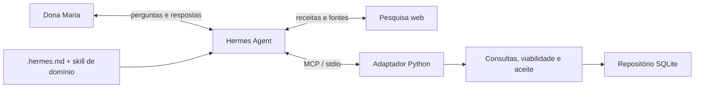

<a id="topo"></a>
<div align="center">

<h1>🍲 Sabor da Maria</h1>

<p><strong>Da despensa ao cardápio. Da conversa a uma decisão com números.</strong></p>
<p>Consultora conversacional de cardápio e precificação com Hermes Agent e Python.</p>
<p>Desafio técnico · Senior AI Engineer · iFood</p>

<p>
<a href="https://github.com/NousResearch/hermes-agent"></a>
<a href="https://www.python.org/"></a>
<a href="https://modelcontextprotocol.io/"></a>
<a href="https://docs.pydantic.dev/"></a>
<a href="https://www.sqlite.org/"></a>
</p>
<p><a href="LICENSE"></a></p>
<p><a href="#desafio">Conheça o desafio</a> · <a href="#executar">Execute o projeto</a> · <a href="#validar">Valide o código</a> · <a href="#sobre-mim">Sobre mim</a></p>
</div>

---

## 📑 Sumário

- [Conheça o desafio](#desafio)
- [Entenda a experiência](#experiencia)
- [Explore a arquitetura](#arquitetura)
- [Entenda a precificação](#precificacao)
- [Prepare seu ambiente](#preparacao)
- [Execute o projeto](#executar)
- [Verifique a implementação](#validar)
- [Explore o repositório](#estrutura)
- [Segurança e limites](#seguranca)
- [Sobre mim](#sobre-mim)

<a id="desafio"></a>
## 🧭 Conheça o desafio

Dona Maria está abrindo seu primeiro delivery. Ela conhece os ingredientes da despensa e quanto pagou por eles, mas precisa decidir **o que consegue produzir e quanto cobrar**.

O Sabor da Maria propõe uma consultora que pesquisa receitas reais, descobre restrições da cozinha e ajuda a planejar um cardápio. A solução parte de uma planilha com as abas `Despensa` e `Precos`, considera **R$ 80,00 para complementos** e uma **taxa de 10% sobre a venda**.

A pergunta central vem antes do preço: **Dona Maria consegue preparar esse prato com os equipamentos, habilidades, ingredientes e condições que tem?**

> [!IMPORTANT]
> O código permite importar a planilha localmente, consultar a despensa e registrar/reabrir candidatas com fontes e lacunas pelo MCP. Esse percurso foi verificado em testes locais determinísticos e em execução assistida do Hermes com pesquisa real. Planejamento de compras, aceite de pratos e precificação permanecem objetivos da solução.

<a id="experiencia"></a>
## 💬 Entenda a experiência

| Etapa da jornada | Responsabilidade da consultora |
| --- | --- |
| **Conhecer a despensa** | Relacionar estoque e histórico de compra sem inventar preços, quantidades ou conversões. |
| **Pesquisar e ouvir** | Consultar receitas reais, apresentar fontes e perguntar sobre interesse e impedimentos. |
| **Verificar a produção** | Descobrir equipamentos, técnicas, tempo e restrições conforme as exigências da receita. |
| **Planejar complementos** | Consolidar faltantes e custos de todos os pratos dentro do orçamento compartilhado. |
| **Pedir o aceite** | Resumir as condições verificadas e aguardar a confirmação explícita de Dona Maria. |
| **Explicar o preço** | Apresentar CMV, taxa e cenários, deixando a escolha final com a usuária. |

**Exemplo ilustrativo de elicitação:**

> **Dona Maria:** Gostei dessa receita assada.
>
> **Consultora:** A receita precisa de forno. Você tem um disponível e espaço para assar esse lote?

Uma condição desconhecida gera uma pergunta. A conversa, sozinha, não autoriza registrar uma decisão de negócio.

<a id="arquitetura"></a>
## 🏗️ Explore a arquitetura

**Hermes conduz a conversa e pesquisa. Python/MCP valida o estado e as regras de negócio.**



| Decisão | Por que foi escolhida |
| --- | --- |
| **Hermes CLI/TUI** | Reutiliza o agente solicitado no desafio e mantém a interação no terminal. |
| **MCP local via stdio** | Expõe ferramentas com contratos explícitos, sem exigir servidor HTTP. |
| **Python separado do host** | Permite testar o serviço sem alterar o ambiente gerenciado do Hermes. |
| **Pydantic 2** | Valida payloads, rejeita campos extras e mantém respostas estruturadas. |
| **SQLite** | Separa o estado de negócio da memória da conversa, com persistência local simples. |
| **Decimal para finanças** | Define a base dos cálculos monetários previstos, sem aritmética financeira em `float`. |
| **Skill de domínio curta** | Orienta o atendimento sem carregar documentos e ferramentas de desenvolvimento. |

O modelo deve suportar chamadas de ferramentas. Provedor, modelo e acesso à pesquisa são configurados privadamente no Hermes; o servidor de negócio não precisa receber essas credenciais. Não há um modelo vencedor declarado sem avaliação da jornada completa.

<a id="precificacao"></a>
## 🧮 Entenda a precificação

As regras financeiras do desafio são:

```text
custo unitário = preço total pago / quantidade comprada
CMV do prato = soma das quantidades utilizadas × respectivos custos unitários
recebimento após taxa = 0,90 × preço de venda
resultado após taxa e ingredientes = 0,90 × preço de venda − CMV
preço mínimo = CMV / 0,90
```

Para **CMV de R$ 18,00 por porção**, o preço mínimo é **R$ 20,00**. Vendendo por R$ 25,00, a taxa é R$ 2,50 e restam R$ 4,50 após taxa e ingredientes. É um exemplo didático, sem receita ou cálculo executado pela aplicação.

O denominador do custo é a **quantidade comprada**, e não o estoque atual. O desembolso com complementos deve respeitar o orçamento agregado; ingredientes já adquiridos continuam compondo o CMV. Outros custos, como gás, embalagem e mão de obra, exigem dados próprios para estimar lucro líquido.

<a id="preparacao"></a>
## 🧰 Prepare seu ambiente

| Ferramenta | Uso |
| --- | --- |
| [Git](https://git-scm.com/) | Obter o código. |
| [Python 3.13+](https://www.python.org/downloads/) | Executar a aplicação; ambiente de referência: Python 3.13. |
| [uv](https://docs.astral.sh/uv/getting-started/installation/) | Instalar dependências pelo `uv.lock`. |
| [Hermes Agent](https://hermes-agent.nousresearch.com/docs/) | Executar a experiência conversacional, com modelo e pesquisa configurados. |

Na pasta em que você guarda seus projetos:

```sh
git clone https://github.com/glaucia86/sabor-da-maria-hermes-agent.git
cd sabor-da-maria-hermes-agent
uv sync --locked --python 3.13
```

Os testes locais usam SQLite temporário e dados sintéticos. Não exigem modelo, credenciais ou chamadas web. A instalação das dependências requer acesso ao registro de pacotes.

<a id="executar"></a>
## 🚀 Execute o projeto

Siga o [guia de instalação e conexão com o Hermes](docs/setup.md). Ele inclui preparação do banco, importação local opcional, configuração do servidor, descoberta da skill e chamadas de verificação.

A [configuração de exemplo](config/hermes.config.example.yaml) contém somente caminhos substituíveis e opções do projeto. Credenciais ficam no perfil privado do Hermes.

Para testar a leitura na conversa, envie:

```text
Use o MCP dona_maria para chamar get_business_state com workspace_id
"00000000-0000-4000-8000-000000000001".
Informe o resultado observado, sem criar workspace ou simular dados.
```

Com o banco sintético vazio, o retorno esperado é `NOT_FOUND`, com `ok=false`, `data=null` e `revision=null`. O identificador é fictício; essa chamada não cadastra uma despensa nem registra uma decisão.

A planilha `despensa_dona_maria.xlsx` é o anexo do desafio e não está distribuída neste repositório. A suíte pública usa fixtures sintéticas; a conferência adicional do original é executada quando o arquivo local está disponível, ou indicada como ignorada pelo pytest.

<a id="validar"></a>
## ✅ Verifique a implementação

Depois de `uv sync`, execute na raiz:

```sh
uv run --locked --no-sync python -X utf8 -B -m pytest tests/unit tests/integration -q
uv run --locked --no-sync ruff check src tests/unit tests/integration
uv run --locked --no-sync ruff format --check src tests/unit tests/integration
```

A suíte verifica importação e diagnósticos por célula, custos de aquisição, leitura sem mutação, registro/revisão de candidatas, replay e rollback em SQLite temporário. Também cobre transporte MCP real, separação de `stdout`/`stderr`, encerramento do processo e resposta ao ping durante lock do SQLite.

O servidor também registra interesse, fatos da cozinha, produção em lotes inteiros
e aceite explícito vinculado à avaliação atual. Os testes cobrem categorias
omitidas, condições desconhecidas ou bloqueadas, insuficiência agregada de
ingredientes, invalidação, retomada e sequências geradas com Hypothesis.
Aceitar um prato preserva estoque físico e orçamento inicial. Cotação de
complementos, cálculo de preços e escolha do cardápio ainda não estão expostos.

O [workflow de CI](.github/workflows/ci.yml) executa esses checks em Windows, Ubuntu e macOS. A execução local em um sistema não comprova sucesso nos demais; consulte os resultados no GitHub Actions.

Testes com fixtures não comprovam pesquisa real nem a qualidade da conversa. Avaliações de elicitação, orçamento, cálculos e decisões humanas dependem da implementação e execução das respectivas jornadas.

<a id="estrutura"></a>
## 🗂️ Explore o repositório

```text
.hermes.md                         Orientação para a consultora
AGENTS.md                          Convenções para contribuir
config/hermes.config.example.yaml  Configuração sem segredos
docs/setup.md                      Instalação e chamada de verificação
skills/dona-maria-cardapio/         Skill de atendimento
src/dona_maria/                    Serviço, repositório e adaptador MCP
tests/                            Testes da aplicação e fixtures sintéticas
pyproject.toml                     Manifesto e ferramentas
uv.lock                            Dependências resolvidas
```

<a id="seguranca"></a>
## 🔒 Segurança e limites

- Páginas web são dados não confiáveis: não autorizam comandos, acesso a segredos ou confirmações humanas.
- O servidor usa SQL parametrizado, conexões somente leitura para consultas e transações com auditoria para registros. Erros omitem caminhos internos e payloads privados.
- SQLite, credenciais, logs privados e transcrições pessoais ficam fora do Git.
- Uma identificação `USER` enviada pelo modelo não autentica consentimento; registrar uma candidata não representa aceite humano.
- Selecionar um cardápio não deve consumir estoque físico nem efetuar compras ou pagamentos.

Este projeto é independente e foi desenvolvido para um desafio técnico. O Hermes Agent pertence à Nous Research; nomes e marcas de terceiros pertencem aos respectivos titulares. O código deste repositório segue a [licença MIT](LICENSE).

---

<a id="sobre-mim"></a>
## 👩🏽‍💻 Sobre mim

<div align="center">
<a href="https://github.com/glaucia86"></a>

<h3>Glaucia Lemos</h3>
<p><strong>Software Engineer · AI Engineer · Educadora · Codex Ambassador</strong></p>
<p>Sou engenheira de software e compartilho conhecimento sobre JavaScript, TypeScript,<br>Node.js e Inteligência Artificial. Meu trabalho conecta desenvolvimento de aplicações,<br>IA generativa e aprendizado prático em comunidades e projetos open source.</p>

<p>
<a href="https://www.youtube.com/user/l32759"></a>
<a href="https://www.linkedin.com/in/glaucialemos/"></a>
<a href="https://github.com/glaucia86"></a>
</p>
<p><a href="#topo">↑ Voltar ao topo</a></p>
</div>
