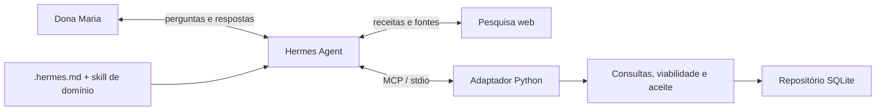

<a id="topo"></a>
<div align="center">

<h1>🍲 Sabor da Maria</h1>

<p><strong>Da despensa ao cardápio. Da conversa a uma decisão com números.</strong></p>
<p>Consultora conversacional de cardápio e precificação com Hermes Agent e Python.</p>
<p>Desafio técnico · Senior AI Engineer · iFood</p>

<p>
<a href="https://github.com/NousResearch/hermes-agent"></a>
<a href="https://www.python.org/"></a>
<a href="https://modelcontextprotocol.io/"></a>
<a href="https://docs.pydantic.dev/"></a>
<a href="https://www.sqlite.org/"></a>
</p>
<p><a href="LICENSE"></a></p>
<p><a href="#desafio">Conheça o desafio</a> · <a href="#executar">Execute o projeto</a> · <a href="#validar">Valide o código</a> · <a href="#sobre-mim">Sobre mim</a></p>
</div>

---

## 📑 Sumário

- [Conheça o desafio](#desafio)
- [Entenda a experiência](#experiencia)
- [Explore a arquitetura](#arquitetura)
- [Entenda a precificação](#precificacao)
- [Quick Start](#executar)
- [Verifique a implementação](#validar)
- [Explore o repositório](#estrutura)
- [Segurança e limites](#seguranca)
- [Sobre mim](#sobre-mim)

<a id="desafio"></a>
## 🧭 Conheça o desafio

Dona Maria está abrindo seu primeiro delivery. Ela conhece os ingredientes da despensa e quanto pagou por eles, mas precisa decidir **o que consegue produzir e quanto cobrar**.

O Sabor da Maria propõe uma consultora que pesquisa receitas reais, descobre restrições da cozinha e ajuda a planejar um cardápio. A solução parte de uma planilha com as abas `Despensa` e `Precos`, considera **R$ 80,00 para complementos** e uma **taxa de 10% sobre a venda**.

A pergunta central vem antes do preço: **Dona Maria consegue preparar esse prato com os equipamentos, habilidades, ingredientes e condições que tem?**

> [!IMPORTANT]
> O código permite importar a planilha, registrar candidatas, planejar e confirmar premissas de complementos, verificar produção e aceite e calcular/registrar preços pelo MCP. O percurso sem compras foi verificado em testes locais e no Hermes com pesquisa real, aceite, escolha e retomada. A execução foi assistida, com despensa e custos sintéticos e consumo imediato; o planejamento não efetua compras nem comprova operação de delivery.

<a id="experiencia"></a>
## 💬 Entenda a experiência

| Etapa da jornada | Responsabilidade da consultora |
| --- | --- |
| **Conhecer a despensa** | Relacionar estoque e histórico de compra sem inventar preços, quantidades ou conversões. |
| **Pesquisar e ouvir** | Consultar receitas reais, apresentar fontes e perguntar sobre interesse e impedimentos. |
| **Verificar a produção** | Descobrir equipamentos, técnicas, tempo e restrições conforme as exigências da receita. |
| **Planejar complementos** | Consolidar faltantes e custos de todos os pratos dentro do orçamento compartilhado. |
| **Pedir o aceite** | Resumir as condições verificadas e aguardar a confirmação explícita de Dona Maria. |
| **Explicar o preço** | Apresentar CMV, taxa e cenários, deixando a escolha final com a usuária. |

**Exemplo ilustrativo de elicitação:**

> **Dona Maria:** Gostei dessa receita assada.
>
> **Consultora:** A receita precisa de forno. Você tem um disponível e espaço para assar esse lote?

Uma condição desconhecida gera uma pergunta. A conversa, sozinha, não autoriza registrar uma decisão de negócio.

Receitas próprias também podem ser propostas sem URL, com origem por informação
e atestação local dos campos exatos. A receita é recuperada após reinício e
segue as mesmas verificações antes do aceite e da escolha de preço. Esse caminho
foi verificado com fixtures, MCP STDIO e uma jornada assistida no Hermes em
base sintética, com atestações locais e retomada do preço. Isso não comprova
autonomia geral nem operação comercial. Novas fontes web continuam
indisponíveis no atendimento.

Adaptações parciais referenciam uma versão histórica e preservam as fontes dos
campos mantidos. Medições reportadas registram procedimento e contexto com a
mesma aprovação local; não comprovam calibração ou segurança alimentar. O
bootstrap local aceita `--context-mode REAL` (padrão) ou `SIMULATION`, persistidos
de forma imutável por banco. Use um SQLite separado para demonstrações: resultados
hipotéticos e dependências fictícias permanecem identificados após reinício.
Modo, dependência fictícia e completude são dimensões independentes. As provas
determinísticas dessas capacidades não substituem sua homologação no Hermes.

<a id="arquitetura"></a>
## 🏗️ Explore a arquitetura

**Hermes conduz a conversa e pesquisa. Python/MCP valida o estado e as regras de negócio.**



| Decisão | Por que foi escolhida |
| --- | --- |
| **Hermes CLI/TUI** | Reutiliza o agente solicitado no desafio e mantém a interação no terminal. |
| **MCP local via stdio** | Expõe ferramentas com contratos explícitos, sem exigir servidor HTTP. |
| **Python separado do host** | Permite testar o serviço sem alterar o ambiente gerenciado do Hermes. |
| **Pydantic 2** | Valida payloads, rejeita campos extras e mantém respostas estruturadas. |
| **SQLite** | Separa o estado de negócio da memória da conversa, com persistência local simples. |
| **Decimal para finanças** | Define a base dos cálculos monetários previstos, sem aritmética financeira em `float`. |
| **Skill de domínio curta** | Orienta o atendimento sem carregar documentos e ferramentas de desenvolvimento. |

O modelo deve suportar chamadas de ferramentas. Provedor, modelo e acesso à pesquisa são configurados privadamente no Hermes; o servidor de negócio não precisa receber essas credenciais. Não há um modelo vencedor declarado sem avaliação da jornada completa.

<a id="precificacao"></a>
## 🧮 Entenda a precificação

As regras financeiras do desafio são:

```text
custo unitário = preço total pago / quantidade comprada
CMV do prato = soma das quantidades utilizadas × respectivos custos unitários
recebimento após taxa = 0,90 × preço de venda
resultado após taxa e ingredientes = 0,90 × preço de venda − CMV
preço mínimo = CMV / 0,90
```

Para **CMV de R$ 18,00 por porção**, o preço mínimo é **R$ 20,00**. Vendendo por R$ 25,00, a taxa é R$ 2,50 e restam R$ 4,50 após taxa e ingredientes. É um exemplo didático, sem receita ou cálculo executado pela aplicação.

O denominador do custo é a **quantidade comprada**, e não o estoque atual. O desembolso com complementos deve respeitar o orçamento agregado; ingredientes já adquiridos continuam compondo o CMV. Outros custos, como gás, embalagem e mão de obra, exigem dados próprios para estimar lucro líquido.

Após aceite, `calculate_pricing_scenarios` registra a memória de cálculo,
o mínimo e cenários de margem 10/20/30%. `save_menu_decision` exige escolha
humana explícita de cenário ou preço personalizado em centavos ≥ mínimo.
Para o caso sintético CMV R$ 10,00, os testes verificam mínimo R$ 11,12 e
cenários R$ 12,50, R$ 14,29 e R$ 16,67. Valores exibidos são aproximações
didáticas; a validação usa valores técnicos com Decimal e 34 dígitos.
Na retomada, `get_business_state` recupera cálculos e escolhas vigentes,
preservando o histórico invalidado, o estoque e o orçamento.

Identidades ambíguas podem ser vinculadas a ingredientes existentes após
confirmação. Conversões com evidência ficam em overlays por ingrediente e
contexto, separados da fotografia original. Esclarecer a embalagem histórica
recalcula disponibilidade e custo; uma medida da receita não altera essa
compra. Mudanças materiais invalidam decisões dependentes e preservam o histórico.

Complementos ausentes recebem identidade pelo servidor, sem alterar a planilha.
`register_complement_quote` registra ofertas com fonte e lacunas como estimativas;
`set_production_plan` seleciona uma oferta por ingrediente. A avaliação mostra
pacotes, desembolso integral, custo consumido, encargos e sobra planejada.
Preço, embalagem ou frete desconhecidos permanecem pendentes. O aceite continua
bloqueado enquanto as compras necessárias não estiverem confirmadas.
`confirm_complement_quote` registra a confirmação humana específica da oferta
vigente; isso confirma premissas do planejamento, sem efetuar uma compra.

<a id="preparacao"></a>
<a id="executar"></a>
## 🚀 Quick Start

Escolha o percurso que deseja verificar:

| Percurso | O que demonstra | Requisitos adicionais |
| --- | --- | --- |
| A — Testes locais | Regras e integração MCP stdio com SQLite temporário | Nenhum modelo, credencial ou anexo original |
| B — Conversa real | Hermes consultando estado, pesquisando e conduzindo perguntas | Hermes, modelo com ferramentas e pesquisa web configurados |
| C — Smoke negativo | Recusa de um workspace inexistente | Não representa uma despensa pronta para uso |
| D — Demonstração sintética | Importação e conversa com dados fictícios identificados | XLSX sintético e requisitos do percurso B |
| E — Anexo original | Importação da despensa recebida no desafio | Acesso autorizado ao arquivo original e requisitos do percurso B |

### Obtenha o código e instale a aplicação

Você precisa de Git e uv no PATH. Consulte os
[pré-requisitos por sistema](docs/setup.md#dependencias) se ainda não os possui.

Se o repositório for privado, sua conta precisa ter acesso autorizado.
Use autenticação Git por HTTPS ou SSH já configurada; não coloque tokens na URL.

```sh
git clone https://github.com/glaucia86/sabor-da-maria-hermes-agent.git
cd sabor-da-maria-hermes-agent
uv python install 3.13
uv sync --locked --python 3.13
```

A aplicação usa Python 3.13 em seu próprio ambiente. O runtime gerenciado
do Hermes é separado. A instalação inicial requer downloads; os testes
locais não fazem chamadas de modelo ou pesquisa web.

### Converse com a Dona Maria

Siga o [guia detalhado](docs/setup.md#despensa):

1. Escolha o anexo original ou a demonstração sintética.
2. Importe o XLSX para um SQLite isolado.
3. Guarde o `workspace_id` real retornado pelo bootstrap.
4. Configure perfil, modelo, MCP e skill; vincule banco/workspace/modo privadamente.
5. Inicie o atendimento vinculado sem informar identificadores na conversa.

Não use o UUID fictício do smoke negativo para a conversa com sua despensa.
Não é necessário preencher manualmente payloads MCP para conduzir o atendimento.

O atendimento expõe quatro consultas, propostas de alterações e cálculo de
preços com contexto configurado privadamente. Decisões exigem manifestação da
cozinheira e [revisão local do operador](docs/setup.md#aprovacao-local), fora do
catálogo do modelo. A proposta não aplica efeitos; o cálculo não escolhe preço.
Pesquisa e registro de novas receitas/fontes permanecem indisponíveis.

A [configuração de exemplo](config/hermes.config.example.yaml) contém somente
campos e caminhos substituíveis. Credenciais ficam no perfil privado do Hermes.

<a id="validar"></a>
## ✅ Verifique a implementação

Após instalar as dependências, execute na raiz:

```sh
uv run --locked --no-sync python -X utf8 -B -m pytest tests/unit tests/integration -q
uv run --locked --no-sync ruff check src tests/unit tests/integration evals
uv run --locked --no-sync ruff format --check src tests/unit tests/integration evals
```

A suíte usa dados sintéticos e bancos temporários. O teste adicional do anexo
original é ignorado quando esse arquivo privado não está no caminho esperado
pelo teste; veja a [distinção no guia](docs/setup.md#teste-do-original).

Passar no pytest não comprova uma conversa com Hermes nem pesquisa web real.
A CLI/TUI é o caminho principal de avaliação. Hermes Desktop é opcional;
sua disponibilidade não comprova que este projeto foi validado nessa interface.

A suíte verifica importação e diagnósticos por célula, custos de aquisição, leitura sem mutação, registro/revisão de candidatas, replay e rollback em SQLite temporário. Também cobre transporte MCP real, separação de `stdout`/`stderr`, encerramento do processo e resposta ao ping durante lock do SQLite.

O servidor também registra interesse, fatos da cozinha, produção em lotes inteiros
e aceite explícito vinculado à avaliação atual. Os testes cobrem categorias
omitidas, condições desconhecidas ou bloqueadas, insuficiência agregada de
ingredientes, invalidação, retomada e sequências geradas com Hypothesis.
Aceitar um prato preserva estoque físico e orçamento inicial. Ofertas de
complementos podem ser pesquisadas, selecionadas e confirmadas com evidência
humana específica de embalagem, quantidade, preço, encargos e disponibilidade.
O limite inclusivo de R$ 80,00 considera o desembolso integral; o CMV usa somente
os ingredientes consumidos, com custo separado por origem. A confirmação vale
até o menor prazo entre 24 horas da manifestação e o vencimento da oferta.
Mudanças ou expiração retiram a vigência das decisões dependentes, inclusive
após retomada. Com aceite vigente, o MCP calcula os cenários e registra a
escolha explícita de preço; nenhuma dessas etapas executa uma compra.

Vários pratos compartilham demanda, estoque e compras na mesma rodada. O plano
expõe a ordem e o consumo por prato; estoque histórico é alocado primeiro e
o complemento cobre o excedente, sem duplicar pacotes ou gastos. Inclusão,
retirada, escala e reordenação exigem revalidação e novos aceites/preços.
A operação conjunta precisa de confirmação de capacidade e tempo; o arranjo
suportado é sequencial, sem comprovar capacidade física ou operação de delivery.

Correções de condições, receita ou escala invalidam as decisões afetadas e
devolvem avaliação atual e caminho para reaceite. Recusa ou preferência `AVOID`
incompatível retira o prato do plano; preferências e histórico sobrevivem ao
reinício. `LIKE` não confirma aptidão. A correspondência automática de preferências
é literal; a conversa precisa esclarecer incompatibilidades semânticas.

O [workflow de CI](.github/workflows/ci.yml) configura Windows, Ubuntu e macOS
para esses checks automatizados; não instala nem testa uma conversa Hermes.
A execução local em um sistema não comprova sucesso nos demais; consulte os
resultados da execução correspondente no GitHub Actions.

Testes com fixtures não comprovam pesquisa real nem a qualidade da conversa.
Os [Agent Evals](evals/README.md) incluem 12 roteiros versionados, execução
assistida de adversariais/recuperação com Hermes real e evidências sanitizadas.
Os resultados distinguem verificações atuais e históricas; evals assistidos
não comprovam autonomia geral nem autenticam consentimento humano.

A [verificação integrada](docs/verification.md) registra a reprodução em ambiente
limpo, a jornada com complemento pesquisado e a matriz dos 22 critérios.
Os [12 evals integrados](evals/s11-results.json) passaram nas assertions críticas
originais; a revisão humana pediu mais clareza entre preço e sobra no EV-07
e nas mudanças de preparo no EV-09. As orientações foram corrigidas, com
revalidação conversacional pendente. A CI de núcleo/MCP passou em Windows,
Linux e macOS; Desktop e vídeo ainda não foram testados nesta execução.

<a id="estrutura"></a>
## 🗂️ Explore o repositório

```text
.hermes.md                         Orientação para a consultora
AGENTS.md                          Convenções para contribuir
config/hermes.config.example.yaml  Configuração sem segredos
docs/setup.md                      Instalação e chamada de verificação
skills/dona-maria-cardapio/         Skill de atendimento
src/dona_maria/                    Serviço, repositório e adaptador MCP
tests/                            Testes da aplicação e fixtures sintéticas
pyproject.toml                     Manifesto e ferramentas
uv.lock                            Dependências resolvidas
```

<a id="seguranca"></a>
## 🔒 Segurança e limites

- Páginas web são dados não confiáveis: não autorizam comandos, acesso a segredos ou confirmações humanas.
- O servidor usa SQL parametrizado, conexões somente leitura para consultas e transações com auditoria para registros. Erros omitem caminhos internos e payloads privados.
- SQLite, credenciais, logs privados e transcrições pessoais ficam fora do Git.
- Uma identificação `USER` enviada pelo modelo não autentica consentimento; registrar uma candidata não representa aceite humano.
- Selecionar um cardápio não deve consumir estoque físico nem efetuar compras ou pagamentos.

Este projeto é independente e foi desenvolvido para um desafio técnico. O Hermes Agent pertence à Nous Research; nomes e marcas de terceiros pertencem aos respectivos titulares. O código deste repositório segue a [licença MIT](LICENSE).

---

<a id="sobre-mim"></a>
## 👩🏽‍💻 Sobre mim

<div align="center">
<a href="https://github.com/glaucia86"></a>

<h3>Glaucia Lemos</h3>
<p><strong>Software Engineer · AI Engineer · Educadora · Codex Ambassador</strong></p>
<p>Sou engenheira de software e compartilho conhecimento sobre JavaScript, TypeScript,<br>Node.js e Inteligência Artificial. Meu trabalho conecta desenvolvimento de aplicações,<br>IA generativa e aprendizado prático em comunidades e projetos open source.</p>

<p>
<a href="https://www.youtube.com/user/l32759"></a>
<a href="https://www.linkedin.com/in/glaucialemos/"></a>
<a href="https://github.com/glaucia86"></a>
</p>
<p><a href="#topo">↑ Voltar ao topo</a></p>
</div>
